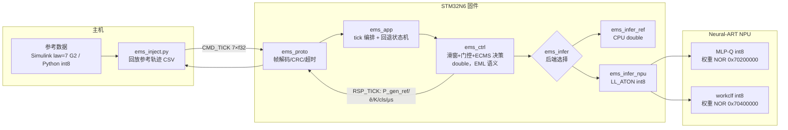

# EMS01 CHIL ECMS 固件 v1 — Design

Spec: `ems01-chil-ecms-v1`
Status: design-approved（2026-08-31 用户批准）
Created: 2026-08-31
Brainstorm: `./brainstorm.md`
Requirements: `./requirements.md`
语义基准: `model/simulink_modelD_(EMS_NN_AECMS)/results/ecms_phase25/gating/eml_ecms_step_mode2.m`
（G2 EML，函数 `ecms_nn`，226 行；下称 **EML**，行号引用即此文件）

## Summary

EMS01 v1 在 STM32N647（ATK-DNN647）上实现预测型 A-ECMS 控制器侧：以 Vendor
`Projects/05_Serial` 为工程起点，移植 `99_Applications/991` 的 NPU 集成模式
（ST Edge AI Core v2.2.0 CLI 生成部署包 + NetworkRuntime1000 + legacy LL_ATON API），
控制律以 EML 为语义基准**手工移植为 C**（方案 A，用户 2026-08-31 按 token 成本裁决，
放弃 MATLAB Coder codegen 方案 B），并以**双推理后端**分层验证：

- **REF 后端**（`ems_infer_ref.c`）：CPU double 前向（权重来自 deploy JSON），
  与 Simulink fp32/float64 参考近 bit 级可比 → 证明控制律移植保真（M2 硬门禁）；
- **NPU 后端**（`ems_infer_npu.c`）：NPU int8（T-307 已校准的 tflite 经 stedgeai 编译），
  最终部署形态 → 板上与 Python int8 reference 一致性（M1 硬门禁，关闭 T-311）。

三层比对隔离三类误差：① fw-REF vs Simulink 参考 = 移植误差；② board-NPU vs
host-int8（同 C 控制律 + Python tflite 推理）= NPU 数值端口误差；③ board-NPU vs
Simulink 参考 = int8 闭环总效应（报告性指标，不做门禁）。

## Goals and Non-Goals

### Goals

- G1（FR-501/502/514）：fw_gate 合规的 CMake 工程 + STEdgeAI 部署链路 + 编译记录归档；
- G2（FR-503/504/505）：MLP-Q int8 板上推理与 Python reference 一致、时延实测 → 关闭 T-311；
- G3（FR-506/507/508）：ECMS + G2 门控 C 移植，与 EML 语义逐条对应，含安全回退；
- G4（FR-509/510）：UART 逐拍注入比对（S20 + ≥1 留出航次），三层比对报告；
- G5（FR-511/512/513）：手动换模型流程文档化走通、fw_gate exit 0、双报告归档。

### Non-Goals

- 模型热切换 / NOR 模型库 / 其它模型上板 / 双模型集成（v2）；CHIL 通信（v3）；
- RTOS、时钟树变更、st-ai API 迁移、MATLAB Coder codegen（方案 B，已裁决放弃）；
- 除 FR-514 权重烧录外的一切 Level C 操作；HIL 机柜相关任何预留。

## Architecture

### 工程目录（目标形态）

```text
EMS01_CHIL_ECMS/                        # = 复制 05_Serial 后改造
├── EMS01_CHIL_ECMS.ioc                 # 05_Serial.ioc 改名 + Appli 上下文补 XSPI2（DEBUG 读 NOR 权重）
├── CMakeLists.txt / CMakePresets.json  # 沿用 05_Serial
├── Model/                              # STEdgeAI 部署包（脚本可重新生成）
│   ├── mlp_q/   {network.c, network_ecblobs.h, user_neuralart.json,
│   │            my_mpools/stm32n6.mpool, generate-n6-model.sh, 源 tflite 副本}
│   └── workclf/ {同上}
├── Appli/
│   ├── Core/...                        # CubeMX 生成（只改 USER CODE）
│   └── App/                            # 自有代码（新增）
│       ├── ems_ctrl.c/.h               # 控制律核心（EML 移植，平台无关，host 可编译）
│       ├── ems_infer.h                 # 推理后端接口
│       ├── ems_infer_ref.c             # REF 后端：CPU double 前向（MLP-Q + workclf）
│       ├── ems_infer_npu.c             # NPU 后端：LL_ATON 封装（双模型实例）
│       ├── ems_proto.c/.h              # UART 帧协议（编解码 + CRC16 + 状态机）
│       ├── ems_app.c/.h                # 应用编排：tick 处理、模式、回退、遥测
│       ├── ems_params.c/.h             # 【生成物】权重/归一化/常数/BSFC 表（禁手改）
│       └── ems_config.h                # 编译开关：EMS_FW_MODE ∈ {REF, NPU}
├── Binary/                             # network-data-*.hex / appli.hex（入库策略按工作区规则）
└── Host/                               # 主机侧工具（PC 运行，python3）
    ├── tools/gen_fw_params.py          # JSON/MAT → ems_params.c/.h 生成器（单一来源）
    ├── tools/gen_reference_int8.py     # Python int8 tflite 推理参考（复用 T-307 口径）
    ├── ems_inject.py                   # 注入/采集/比对主工具
    └── tests/test_ctrl_diff.py         # L0 主机差分单测（gcc 编译 ems_ctrl + REF 后端）
```

### 模块与数据流



**关键架构决策**：

1. **ems_ctrl 平台无关**：不含任何 HAL 调用，推理经 `ems_infer.h` 接口注入；
   同一 `.c` 文件既编入固件也被主机 gcc 编译做 L0 差分单测——移植保真的制度保证。
2. **控制律数学用 C `double`**（与 EML/MATLAB 一致）：M55 双精度为软件模拟，
   但 1 Hz ×（51 点网格 + 两个小网络前向）计算量 << 预算（NFR-501/505）；
   REF 后端权重数组亦 double（~200KB SRAM，预算内）。生产化是否降 float 留 v2 评估。
3. **EML 实际只用 4 个动态信号**（t, P_load, SOC, v_ship；EML:1）：accel 由控制律
   自行按 tick 差分（EML:55-56 `vprev`），v_cmd/x_ship 不进入控制律。注入帧仍携带
   全 7 信号（CHIL 信号集 7→1 一致性，前向兼容），固件 v1 只消费 4 个。
4. **tick 驱动**：注入/部署形态下每个 CMD_TICK 即一个控制拍（1 Hz 节奏由 plant/主机侧
   保证）；EML 内部的 `t-lastT<dt` 早退守卫（EML:47-48）在固件映射为"按命令处理"，
   部署行为等价。推理、门控、ECMS 全部每拍执行一次。
5. **NPU 初始化序列照抄 991**（main.c USER CODE）：`SystemIsolation_Config`（RIF
   RIMC/RISC 含 NPU 主从授权）→ `npu_config()` → `npu_cache_config()` →
   DEBUG 模式 `MX_XSPI2_Init` + NOR Flash memory-mapped（读 0x70200000 权重的前提）。
6. **时钟不动**（NFR-508）：Debug/Release 均 CPU 600MHz、NPU IC6 300MHz。
   时延测量用 DWT CYCCNT（代码使能，不涉及 .ioc/时钟树）。

### 内存布局（fw_gate 契约兼容）

| 区域 | 地址 | 内容 | 备注 |
|---|---|---|---|
| NOR FSBL | 0x70000000 | 既有 FSBL | **不动** |
| NOR Appli XIP | 0x70100400 | Release appli（仅构建验证，不烧录） | fw_gate Release 契约 |
| NOR 权重 | **0x70200000** | MLP-Q int8 权重 bin（26.2KB，预留 1MB） | FR-514 授权烧录 |
| NOR 权重 | **0x70400000** | workclf int8 权重 bin（39.1KB，预留 1MB） | FR-514 授权烧录 |
| AXISRAM3~6 | 0x34200000 起 | NPU 激活/工作区（mpool vendor 默认，运行时地址） | 不占 ELF 段 |
| Internal SRAM | 0x34000400 起 | Debug 全部段（fw_gate 契约）/ Release RAM | ems_params ~200KB 在内 |
| HyperRAM | 0x90000000 | mpool 溢出区（v1 两小模型预期用不到） | 禁止链为 ELF 段 |

- 权重绝对寻址烘入各模型 `network.c`（991 同款机制），不进 ELF → 不触发布局契约；
- `network_atonbuf.xSPI2.raw` 经 objcopy `--change-addresses` 生成两个 hex
  （`Binary/network-data-mlpq.hex` / `network-data-workclf.hex`），一次授权烧录会话写入；
- 两模型 mpool 各自复制 vendor 模板、仅改 constants 池基址与容量。

### CMake 集成（Appli/CMakeLists.txt 用户维护块）

prepare 脚本**不会**自动接 `Middlewares/AI`（非扁平中间件）→ 手写块（marker 注释包围，
与 ATK AUTO 三块并存互不覆盖）：

- `target_sources`：`App/*.c`、`Model/mlp_q/network.c`、`Model/workclf/network.c`、
  `Middlewares/AI/Npu/Devices/STM32N6XX/npu_cache.c`（**引用 vendor 原路径，不复制**）；
- `target_include_directories`：`Middlewares/AI/Inc`、`.../Npu/Devices/STM32N6XX`、
  `Model/mlp_q`、`Model/workclf`、`App`；
- `target_link_libraries`：`Middlewares/AI/Lib/GCC/ARMCortexM55/NetworkRuntime1000_CM55_GCC.a`；
- 两模型的 `LL_ATON_DECLARE_NAMED_NN_INSTANCE_AND_INTERFACE` 经宏区分实例名
  （mlp_q / workclf），`ems_infer_npu.c` 封装为后端接口。

## Data Model

### 参数单一来源（FR-503/NFR-506 的制度实现）

`Host/tools/gen_fw_params.py`（仓库内，python3 + scipy）读取：

| 源（只读） | 提供 |
|---|---|
| `results/ecms_phase25/deploy/selected_model_weights_v2.json` | MLP-Q fp32 权重（W1/b1/W2/b2/W3/b3）、workclf 权重（conv1~3/fc1~3）、gate 常数（S1/S2/M/upstream_id） |
| `datasets/fleet_norm_v2.json` | X_mean/X_std(302)、y_mean/y_std |
| `results/ecms_phase1/kS_calibration.json` | λ₀=0.425、K_soc=30、K_S=0.01、Λ_floor=0.43、SOC_ref=0.60、Ē_H=36.8933…、E_scale=20.5069… |
| `config/ecms_bsfc_override.mat` | BSFC 501 点表（tag `ecms-bsfc-family-mid-d25=0.50-agg-v0.1.0`；**必须用 override 表**，7 点默认表数值差异大） |
| `config/Model_Parameters.m`（人工核对清单） | η_rect=η_dcdc=0.97、Bat_Eff=0.95/0.95、SOC 限 0.105/0.945、Idle_Fuel=6.795、Grid dP=20、Gen_P_max=1000、Pgen_init=0、dt_ctrl=1 |

→ 生成 `ems_params.c/.h`（文件头含各源文件 sha256 + 生成时间，"GENERATED DO NOT EDIT"），
**提交入库**（构建不依赖 Python 即可复现；源变更 → 重跑脚本 → diff 可审）。
EML 字面量常数与该 JSON 同源（python/export/gen_eml_gate.py 生成），故 REF 后端与
Simulink 参考在常数层面天然一致。

### 滑窗与控制状态（ems_ctrl 内部，复刻 EML）

- `double buf[300]` 环形缓冲 + `k` 指针；**初始化/新航段（t<lastT）= 整窗平 fill 当前
  P_load**（EML:31-32/36-43，禁止零填充）；`isfinite` 失败跳过写入但指针前进（EML:51-54）；
- `Pheld`（tick 间输出保持，初值 Pgen_init=0）；`vprev`（accel 差分）；
- 门控状态机 `cls_eff/run_cls/run_cnt`（EML:136-148）：首个判决直接采纳；同类复位计数；
  连续 **3 个控制 tick** 同新类才切换（**单位=1 Hz tick = 3 s**——README_Model.md 的
  "m=3 窗（30s）"为离线 10s 窗口径，与 EML 实现不符，以 EML 为准，文档修正列入收尾任务）；
- argmax/argmin 平局取**首个**（MATLAB max 语义，EML:134/215-218）；
- SOC≤0.105 分支：取**首个满足 Pbat≤0 的 Pg 并 break**（非 J 最优，EML:183-189）+
  末尾救急分支（EML:220-222）；禁止"优化"成统一 argmin；
- 目标函数 `J = mf + λ·mbe`：mf 单位链 `Pg[kW]·bsfc[g/kWh]/3.6e6 [kg/s]`，
  mbe 放电 `/η_dcdc/η_bat/3600`、充电 `·η_dcdc·η_bat/3600`（负值），
  3.6e6 与 3600 的混用是公式一部分，不得"统一"（EML:193-214）；
- BSFC 插值：端点钳位 + `while(ii<nb-1 && bp(ii+1)<Pg)` 严格小于（EML:196-207）。

### UART 协议（FR-510，单线 USART1 @115200 8N1）

二进制帧（小端）：

```text
[0xAA 0x55] [TYPE u8] [LEN u16] [PAYLOAD LEN B] [CRC16-CCITT u16 over TYPE..PAYLOAD]
```

文本日志行以可打印 ASCII 开头、`\r\n` 结尾；固件保证日志行首字节 ≠ 0xAA，
主机按首字节 0xAA 分流二进制帧 / 文本行。

| TYPE | 方向 | 名称 | Payload | 说明 |
|---|---|---|---|---|
| 0x01 | H→F | CMD_RESET | — | 复位控制状态（下一 tick 平 fill）；回 ACK |
| 0x02 | H→F | CMD_TICK | tick_idx u32 + 7×f32 [t,P_load,SOC,v_cmd,v_ship,accel,x_ship] | 一个控制拍 |
| 0x03 | F→H | RSP_TICK | tick_idx u32 + P_gen_ref f32 + e_hat f32 + K f32 + cls_eff u8 + infer_us u32 + ctrl_us u32 + flags u8 | 控制遥测 |
| 0x04 | H→F | CMD_INFER_TEST | 302×f32 原始特征（物理量） | M1 一致性自测：固件归一化→NPU 推理 |
| 0x05 | F→H | RSP_INFER_TEST | q10/q50/q90 f32 + infer_us u32 | kWh |
| 0x06 | H→F | CMD_PING | — | 链路检查 → ACK |
| 0x07 | H→F | CMD_DUMP_EVENTS | — | 导出故障事件环（type+tick 序列，文本行输出） |
| 0x7F | F→H | ACK | echo TYPE u8 | |
| 0x7E | F→H | NACK | echo TYPE u8 + err u8 | CRC 错/未知命令/状态非法 |

超时：注入会话中主机等待 RSP 超时 500ms 记 TIMEOUT 事件；固件侧 CMD_TICK 间隔
>2s（注入中）置 STALE 标志并保持 Pheld。帧内 7 信号语义与单位固定
（kW / [0,1] / m/s / m/s / m/s² / m / s），协议语义变更属主 Agent 决策。

## API / Interface Changes

- `ems_infer.h`（固件内部接口）：
  `int ems_infer_mlpq(const double x302[302], double q3[3], uint32_t *us);`
  `int ems_infer_workclf(const double pdec30[30], double v, double a, int *cls, uint32_t *us);`
  返回值 0=OK，非 0=推理失败（触发 FR-508 回退）。REF/NPU 两实现经
  `ems_config.h` 的 `EMS_FW_MODE` 编译期选择。
- 主机 CLI：
  `python3 ems_inject.py --port <tty> --trace <csv> --ref <csv> --out <report_dir>`
  （回放 → 采集 → 三层比对报告 + `fw_compare.csv/json`）；
  `python3 tools/gen_fw_params.py`（重新生成 ems_params）；
  `python3 tools/gen_reference_int8.py --vectors <npz/csv> --out <csv>`
  （Python int8 tflite 推理参考，复用 T-307 tflite 与归一化，供比对层②）。
- STEdgeAI（每模型，命令行可复现，NFR-503）：
  `stedgeai analyze --model <m>.tflite --target stm32n6`（HW coverage/RAM 报告 → 归档 FR-502）；
  `Model/<m>/generate-n6-model.sh` = `stedgeai generate --no-inputs-allocation
  --no-outputs-allocation --model <m>.tflite --target stm32n6 --st-neural-art
  default@user_neuralart.json` + objcopy → `Binary/network-data-<m>.hex`。
- 构建/准备/Gate：`cd SoftwarePackage && python3 Tools/atk_stm32n6_cmake_prepare.py
  EMS_Projects/EMS01_CHIL_ECMS [--build Debug|Release]`；
  `python3 firmware/gate/fw_gate.py <EMS01 路径>`（.ioc 授权期 `FW_GATE_ALLOW_IOC=1`）。

## Error Handling（FR-508 回退状态机）

```text
INIT ──首 tick 平fill──> ACTIVE ──任一失败──> FALLBACK(ê=0 ≡ law=5 行为)
                              ▲                     │ 连续 N=5 tick 正常
                              └────────── 恢复 ──────┘
```

- 失败集合（与 EML `ok` 条件一致并扩展）：权重/部署包完整性校验失败（NPU 网络 init
  返回非零，或 NOR 权重区 CRC32 与生成时记录值不符）/ 推理返回非零 / 输出非有限 /
  输入 P_load·v_ship·accel 非有限（该 tick ê=0，滑窗按 EML 规则跳过写入）；
- FALLBACK 中 ECMS 网格决策照常（ê=0 → soc_ref_eff=SOC_ref，即 law=5 行为，EML:166-169）；
  记录故障事件环（type+tick，CMD_DUMP_EVENTS 导出）；
- UART 帧 CRC 错 → NACK + 事件；注入中超时 → STALE + 保持 Pheld（不得突然归零或突变）；
- 识别器输出类别 ∈[1,7] 之外的非法值 → 该 tick 按非 upstream（K=1）处理并记录事件
  （不得因识别异常误关预测；逆水关断的误动作方向是保守的，反向才需防护）。

## Security and Privacy

- 硬件操作授权边界（requirements Out of Scope 例外条）：Level A/B + 唯一 Level C
  （FR-514 权重烧录，专用外部加载器，禁 Mass Erase，保 FSBL）——实施任务中逐条核对；
- `.ioc` 变更仅限已授权范围（05_Serial 复制改名 + Appli 上下文 XSPI2 增补），
  Gate 以 `FW_GATE_ALLOW_IOC=1` 重跑；
- 无网络面/无密钥/无用户数据；UART 协议仅实验室主机连接。

## Testing Strategy

- **L0 主机单测（无硬件依赖，先行）**：
  - `test_ctrl_diff.py`：gcc 编译 `ems_ctrl.c + ems_infer_ref.c + ems_params.c`，
    喂参考轨迹输入，逐 tick 对比 Simulink 参考 P_gen_ref。
    **硬门禁（design 固定）：≥99% tick 完全一致（同网格点），最大偏差 ≤1 网格步（20 kW）**；
  - 单元用例（复刻 EML 风险清单）：平 fill 初始化 / t<lastT 全复位 / NaN 跳写 /
    argmax 平局取首 / SOC≤0.105 的 break 与救急分支 / 迟滞 3-tick 切换与同类复位 /
    BSFC 端点钳位与插值 / 充电禁止分支；
  - 协议编解码环回测试（CRC 正/反例、截断帧、垃圾字节流恢复）。
- **L1 板上 M1（用户在场，SRAM Debug + 权重烧录）**：
  - FR-504：CMD_INFER_TEST × **200 个测试向量**（val split 固定 seed=20260831 抽样，
    原始物理量输入），板载（归一化+NPU int8）vs Python int8 reference。
    **硬门禁（design 固定）：max |Δq50| ≤ 0.25 kWh（≈1.2% E_scale），
    board-vs-python RMSE 比 ≤ 1.1**；workclf 同法（类别一致率 ≥99%，logits max |Δ|
    报告）；conv1d SW fallback 属预期，记入 FR-502 fallback 清单；
  - FR-505：DWT CYCCNT 实测 MLP-Q / workclf 推理时延（预算 ≤10ms / 合计 ≤20ms）；
  - FR-502：stedgeai analyze 报告（HW coverage、activation RAM、weight memory、
    fallback 算子清单）+ generate 日志归档。
- **L2 板上 M2（同会话或紧随）**：
  - FR-509：注入 S20 片段 + ≥1 段留出航次（v2 split test 航次），三层比对
    （① REF 模式硬门禁同 L0；② NPU 模式 vs host-int8：≥99% tick ≤1 网格步；
    ③ NPU 模式 vs Simulink 参考：分布报告，报告性不设门禁——design 固定口径，
    阈值的任何修改 = design 修订，禁止为 PASS 调整）；
  - FR-508 故障注入：NaN 输入 / 停发超时 / 垃圾帧 / CMD_RESET 恢复，逐项观察回退行为。
- **回归**：fw_gate exit 0（FR-512）；L0 差分单测纳入"改动 ems_ctrl/ems_params 必跑"。

## Rollout and Migration

任务序列（tasks.md 细化；硬件无关任务前置，板上会话合并以最少占用用户时间）：

```text
T-501 工程骨架（复制 05_Serial→改名→.ioc 增补 XSPI2→prepare→构建→首次 gate）
T-502 STEdgeAI v2.2.0 装机核验 + 两模型 analyze/generate + 编译记录归档（FR-502）
T-503 gen_fw_params.py + ems_ctrl.c 移植 + L0 差分单测（纯 PC，EML 为基准）
T-504 CMake AI 集成 + ems_infer_npu + INFER_TEST 链路 + 构建通过（离线）
T-505 ems_proto + ems_inject.py + 协议环回测试（离线）
T-506 M2 参考轨迹生成（MATLAB 脚本 66_export_fw_reference.m：S20 + ≥1 留出航次，
      law=7 G2 逐 tick 导出 7 输入 + P_gen_ref；脚本驱动禁 GUI）
T-507 板上会话（用户在场）：权重烧录（FR-514 授权）→ SRAM Debug →
      L1 板上 M1 验证 → M1 部署报告 → 引用关闭 phase25 T-311
T-508 L2 板上 M2 注入比对 + 故障注入 → M2 移植验证报告
T-509 收尾：fw_gate、EMS01 README 结构补全 + NOR 容量更正（32MB）、
      README_Model.md 迟滞口径修正（3 ticks）、索引/进展日志、§15 汇报、提交
```

回退策略：任何任务失败不影响既有资产（全部新增文件；05_Serial 原工程不动；
权重烧录区域与 FSBL/既有 appli 不重叠）；ems_params 重新生成即回滚到 JSON 源语义。

## Requirements Traceability

| Requirement | Design Decision | Validation |
|---|---|---|
| FR-501 | 05_Serial 复制改造 + .ioc 增补 XSPI2（Architecture §工程目录） | T-501：prepare 重复运行 + fw_gate 结构项 |
| FR-502 | stedgeai analyze/generate 归档（API §STEdgeAI） | T-502：analyze 报告 + generate 日志 |
| FR-503 | gen_fw_params 单一来源生成 ems_params（Data Model） | L0 差分 + 生成物 sha256 溯源头 |
| FR-504 | INFER_TEST 协议 + Python int8 参考（Testing L1） | T-507：200 向量，max\|Δq50\|≤0.25 kWh |
| FR-505 | DWT CYCCNT 测量（Architecture §6） | T-507：RSP 遥测 infer_us |
| FR-506 | ems_ctrl 逐条复刻 EML 决策（Data Model §滑窗） | L0 差分硬门禁 |
| FR-507 | 门控状态机复刻（Data Model §门控） | L0 单元用例 + L2 注入 |
| FR-508 | 回退状态机（Error Handling） | L2 故障注入记录 |
| FR-509 | 三层比对 + S20/留出航次（Testing L2） | T-508 报告 |
| FR-510 | 帧协议表（Data Model §UART） | 协议环回测试 + 文档 |
| FR-511 | generate-n6-model.sh + 换模型流程（API） | T-508：同 MLP-Q 走一遍全流程 |
| FR-512 | fw_gate（Rollout T-509） | exit 0 |
| FR-513 | M1/M2 双报告（Rollout T-507/508） | 主 Agent §14 验收 |
| FR-514 | NOR 布局表 + 烧录纪律（Architecture §内存布局） | T-507 烧录记录（镜像/地址/加载器） |
| NFR-501/502 | 1Hz 预算 + mpool 布局 | FR-505 实测 + analyze 报告 |
| NFR-503 | 全命令行链路（API） | 重跑复现 |
| NFR-504 | 阶段隔离 + 唯一 Level C 例外 | 任务授权核对（T-507） |
| NFR-505 | 裸机 tick 编排 + CYCCNT 测量 | RSP 遥测 ctrl_us |
| NFR-506 | double 控制律 + 单一来源参数 | L0 硬门禁 |
| NFR-507 | README/日志同步（Rollout T-509） | §14 检查 |
| NFR-508 | 时钟不动（Architecture §6） | .ioc diff 审查（仅 XSPI2 增补） |

## Risks and Trade-offs

- **R1 STEdgeAI v2.2.0 本机未装**（下载需 ST 账号）→ T-502 首步核验；analyze 可临时用
  Developer Cloud 替代，generate 必须本地 CLI（NFR-503）。
- **R2 workclf Conv1D 回退 CM55 软件执行**（tflite CONV_1D 不在 NPU 映射表）→ 预期内，
  7.8K 参数 SW 开销可忽略；如实记入 fallback 清单（T-311 要求项），不改模型导出形态。
- **R3 NPU int8 vs Python tflite 解释器数值差**（累加顺序差异）→ 层②门禁 99% ≤1 网格步；
  若系统性超差，Escalate（可能需 `--native-float` 等编译选项调整 = design 修订）。
- **R4 float32 协议帧 vs double 内部表示**：注入值经 f32 传输引入 ≤1e-7 相对误差，
  对网格决策影响可忽略（L0 门禁内含此因素，因 L0 走 double 直连；L2 实测验证）。
- **R5 05_Serial.ioc 无 XSPI2 配置**（991 有）→ .ioc 增补 Appli 上下文 XSPI2
  （授权范围内）；若 prepare 对该增补的 linker 处理异常 → Escalate，不改 linker 契约。
- **R6 板上 NOR 现存内容未知**（991 demo 权重曾烧 @0x70200000 约 29.7MB）→
  T-507 烧录前 Level A 读取确认区域现状；只写自有两段，其它区域不动。
- **R7 迟滞口径文档矛盾**（EML=3 ticks/3s vs 文档"30s"）→ 以 EML 为准，
  README_Model.md 修正列入 T-509（主 Agent 复核）。
- **R8 双后端代码漂移**（REF 与 NPU 输入预处理两处实现）→ 预处理（滑窗/归一化/
  Pdec 抽取）只在 ems_ctrl 实现一份，后端仅做张量前向（REF=double 数组，
  NPU=int8 量化由 tflite 内参数完成，固件侧喂归一化后 float 经
  LL_ATON 输入缓冲，量化零点/尺度由生成物保证——T-504 实测验证输入语义）。
