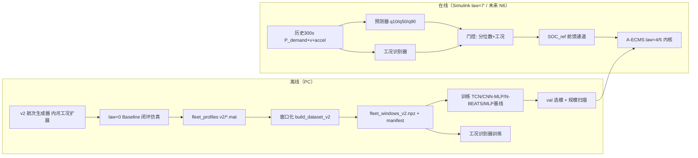

# Phase 2.5 NPU 导向模型族优化与工况识别门控 — Design

Spec: `nn-predictive-ecms-phase25`
Status: design-approved（2026-08-28 外部评审 4+1 项修订后批准）
Created: 2026-08-28
Brainstorm: `./brainstorm.md`
Requirements: `./requirements.md`

## Summary

在 Phase 2 已验证的"预测 Ê_H → SOC_ref 前馈 → A-ECMS"架构不变的前提下，做三件事：
(1) **数据集 v2**——内河工况导向的生成器多样性扩展 + K-shape 覆盖度审计，回应
"数据集多样性决定模型上限"的用户关切；(2) **NPU 导向模型族**——TCN 主推、CNN-MLP 与
N-BEATS 对照，全部带多分位数头，规模在 NPU 实时预算内放大，与 Phase 2 MLP 基线公平对照；
(3) **在线工况识别 + 失败模式门控**——CNN 分类器从历史窗口识别当前工况（纯部署可得输入），
对 S07 类模式做通道保护。三条线汇聚到同一判定：**S20 capture 复测**（沿用 Phase 2 口径）。

文献锚点：Yan et al. 2025（工况识别→控制器调整的标准范式；CNN+ECA 分类器 NPU 友好）；
沈崇崇等 2026（模式门控多 NN→等效因子，最优经验注入——列为后续候选，不进主线）。

## Goals and Non-Goals

### Goals

- G1（FR-301~304）：数据集 v2 分布更广且可审计，泄漏纪律零退化。
- G2（FR-305~309）：TCN/CNN-MLP/N-BEATS 与 MLP 基线的公平对照表 + NPU 权衡曲线。
- G3（FR-310/311）：工况识别器可用；S07 类失败模式有经批准的门控保护。
- G4（FR-312/313）：capture 主指标复测结论 + int8/NPU 部署数据。
- G5（FR-314/315）：全链可复现，失败实验完整保留。

### Non-Goals

- 不引入航次计划先验特征（用户否决）；不做海况扰动（内河船）；不替换 A-ECMS 骨架；
  不做 LSTM/GRU 扩展；不做 DP 模仿学习主线；不做固件集成（Phase 3）。

## Architecture

### 总体数据流（v2 目标态）



关键边界（与 Phase 2 相同，不得改变）：**预测与控制概念分离**；预测器不直接输出
Pgen/Pbat/λ；SOC_ref 通道是预测影响控制的唯一路径；门控只调制该通道
（增益/回退），不新开控制路径。

### Fixed Decisions（不可重新设计）

- D1 预测目标不变：Ê_H(t) = Σ P_demand(t+1..t+300)/3600 [kWh]（与 Phase 1 oracle 端点
  口径差 ≤0.22 kWh，沿用 Phase 2 fleet_norm.json target_note 的处理）。
- D2 预测器输入不变：302 维 = [P_demand(t−299..t) ×300, v_ship(t), accel(t)]；
  **禁止加入任何未来/计划信息**。
- D3 Split 纪律不变：航次级、种子固定、test 零参与、S20/S01/S02/S07 隔离。
- D4 判定口径不变：S20 为唯一设计判定场景；capture = (C2−C4)/(C2−C3)；合格线 ≥0.50。
- D5 控制内核不变：law=4/5 A-ECMS + λ 标定（kE/kS/λ）不改；新增内容只能是
  预测器替换、识别器新增、门控新增。
- D6 NPU 算子白名单：Conv1D（可用 Conv2D 1×k 表达）、Dense、池化、ReLU 族、
  Add/Concat；禁止 LSTM/GRU；注意力层须先过 STEdgeAI 编译验证。

## Data Model

### 数据集 v2（FR-301~304）

- 生成器扩展点（须逐项物理论证，T-301 产出论证文档）：
  - 段参数范围放宽（v、时长区间）；
  - 段型组合规则放宽（中间段数、逆水段约束保持 ≤1）；
  - **内河扰动候选**（论证后取舍）：段内流速缓慢变化（水位/流量）、
    交通避让减速事件、装载/水位对阻力系数的影响；
  - N 规模：200 → 候选 400（评审定）。
- 明确**不做**：波浪/海况随机力（内河船不适用——用户 2026-08-28 明确）。
- v2 窗口化复用 v1 管线规则（HIST=300/HORIZON=300/STEP=10），输出
  `datasets/fleet_windows_v2.npz` + `fleet_norm_v2.json` + `dataset_manifest_v2.json`
  （含逐文件 md5、split 名单、泄漏断言、y 分布同族检查）。
- K-shape 审计（FR-303）：对 v2 全航次的 P_demand 剖面聚类，报告类数、类内/类间距离、
  v1 vs v2 覆盖对比图；结论入 manifest。
- **交叉 split 近邻重复审计（FR-316，v1.1）**：生成航次可能是同模板微调参数，须防止
  train/test 出现模板级近重复。方法：以航次 P_demand 剖面为对象，复用 K-shape/距离
  设施计算**跨 split** 航次对相似度；输出跨 split 最近邻航次对清单 + 相似度分布，并与
  split 内最近邻分布对比；判定规则（T-303 实现时固定并写入 manifest）：跨 split 最近邻
  距离显著小于 split 内分布低分位（如 < p1）者标记为疑似模板泄漏；处置（保留并声明 /
  换种子重抽）记录于 manifest，不得静默忽略。
- 存储策略：`.mat` 与 `.npz` 不入库（沿用 v1 惯例），manifest/norm/审计报告入库。

### 模型族（FR-305~309）

统一输入重排：302 维 → 序列视图 (300,1) 的 P_demand 通道 + 标量通道 [v, accel]
（具体拼接方式在各模型 config 中固定并记录）。

- **TCN（主推）**：因果 Conv1D 残差块堆叠，扩张率 1,2,4,…,2^k，
  感受野 R = 1 + 2·Σ(2^i)(k−1) ≥ 300（推导必须写入训练脚本注释）；
  全局池化/末时刻取特征 → MLP 头 → 3 输出（q10/q50/q90，pinball loss）。
- **CNN-MLP**：Conv1D 编码器（2~3 层）→ 池化 → MLP 头，同分位数输出。
- **N-BEATS 式**：全连接残差栈（basis blocks），输入 302 维平直向量，同分位数输出。
- **MLP 基线**：复用 Phase 2 权重与训练配置（v2 上重训一次以保持公平）。

规模扫描（FR-308）：主推架构至少 3 个规模点（如 channels ∈ {32, 64, 128}），
每点记录 params / int8 大小 / val 指标 / 时延估算或实测。

### 选模协议（FR-317，v1.1）

```text
① prediction qualification
   val 指标（RMSE/MAE/R²/under_freq/分位数校准）仅作资格筛选，淘汰明显劣势配置
        ↓
② closed-loop selection
   闭环 capture（S20）+ 消融（S01/S02/S07）+ 留出门禁（FR-318）
        ↓
③ NPU Pareto selection
   闭环合格者按部署成本（int8 大小/时延/HW coverage）做 Pareto 前沿
   最终 Winner 由主 Agent 综合裁决（精度 × 闭环 × 部署三维）
```

原则：最终目标不是“预测数字最准”，而是“闭环表现最好且能在 STM32N6 高效运行”。
val RMSE 单独排名仅适用于 v1 回归保护（--dataset v1 复现 Phase 2 的 9.303 kWh），
不得作为 v2 最终 Winner 的唯一依据。

### 工况识别器（FR-310）

- 输入：与预测器相同的历史窗口（可降采样，如 10 s 重采样到 30 点以缩小模型）。
- 标签来源（OQ-3，T-308 前须定）：首选**生成器段型真值**（7 类，仿真内天然可得、
  无标注成本）；备选 K-means/聚类重划分（参照 Yan et al.，需额外论证）。
- 架构：小型 Conv1D 分类器（参照 Yan et al. 3 conv + pooling + FC；ECA 注意力可选，
  引入前须过 STEdgeAI 编译验证）。
- **定位（v1.1）**：识别器是**候选**门控组件，不预设进入最终架构——最小复杂度原则：
  能用简单机制解决就不部署第二个神经网络。是否纳入最终方案由 T-309/T-310 的
  G0~G3 消融裁决。
- 评估（v1.1 扩展）：test split 的 macro-F1、per-class recall、失败敏感类
  （桥区/靠离泊）recall、段切换窗口识别率、transition latency；
  overall accuracy ≥80% 不得作为唯一验收门槛（必须排除“常见工况 95% + 危险工况 40%”
  的平均数掩盖）。

### 门控（FR-311，T-309 设计门）

设计空间（主 Agent 在 T-309 裁决其一或组合）：
- (a) 工况门控：识别为桥区/靠离泊类 → 预测通道增益 K_S→0（回退 law=5 语义）；
- (b) 分位数门控：q90−q10 不确定性超阈值 → 通道降增益；
- (c) 组合。
约束：门控逻辑必须确定性的、可单元测试的（沿用 law 框架 + test_ecms_law 模式）；
不得引入新的不可复现状态。

**消融矩阵（v1.1，T-310 闭环必跑）**：

| 配置 | 分位数门控 | 工况识别门控 | 用途 |
|---|---|---|---|
| G0 | ✗ | ✗ | 基线（纯预测通道） |
| G1 | ✓ | ✗ | 单机制消融 |
| G2 | ✗ | ✓ | 单机制消融 |
| G3 | ✓ | ✓ | 组合 |

决策规则：仅当 G2/G3 相对 G1 展现**明确闭环增量**（S07 回退消除 + S20 capture 不显著
损失 + 留出门禁通过）时，工况识别器才进入最终部署架构；否则最终形态为
Predictor + 分位数门控 + A-ECMS。

## API / Interface Changes

### NPU on-target 验证（FR-319，v1.1）

- 中间证据：STEdgeAI desktop 分析 / Developer Cloud 估算（HW coverage、内存池、
  估算时延）允许用于 T-307 规模扫描与迭代决策；
- 最终验收：必须在真实 STM32N6 板上完成 int8 推理验证，记录：int8 模型大小、
  activation RAM、weight memory、Neural-ART HW coverage、SW/HYBRID fallback 算子
  清单、实测推理时延、fp32 vs int8 精度差、板上输出 vs Python reference 一致性误差；
- 官方警告（ST 文档）：落 CPU 的算子可能比 NPU 慢 1~2 个数量级，参数量/MAC 数
  不能替代 target validation；
- 固件侧操作分阶段授权（AGENTS.md §11）：Build / fw_gate / Debug / Flash 各自独立授权，
  板上验证前需用户明确批准对应阶段；无板可用时 T-311 停在中间证据并 Escalate，
  不得以估算充最终验收。

- 新脚本沿用编号约定：`scripts/60_*`（数据集 v2）、`scripts/61_*`（模型族训练入口可
  复用 `python/train_predictor.py` 加 `--arch` 参数）、`scripts/62_*`（识别器）、
  `scripts/63_*`（门控集成）、`scripts/64_*`（闭环矩阵 v2）、`scripts/65_*`（repro v2）。
- `python/train_predictor.py` 增加 `--arch {mlp,tcn,cnn_mlp,nbeats}` 与
  `--quantiles q10,q50,q90`、`--dataset v1|v2` 参数；默认行为不变（向后兼容 v1 复现）。
- law 框架：门控实现优先走现有 Variant/参数通道；若必须新增 law=8，
  属设计层变更，T-307 门内由主 Agent 决定。
- 所有新增文件同步登记所在目录 README（AGENTS.md §20）。

## Error Handling

- 数据集 v2 y 分布同族断言失败 → 停，评审生成器改动，不得放宽断言。
- STEdgeAI 编译失败（算子不支持）→ 记录失败 + 结构回退（白名单内替换），
  不得静默改用 CPU 回落结构充数。
- 识别器 test 准确率 <80% → 不上门控主线，门控退化方案（仅分位数门控）须记录。
- 留出航次 capture 单点异常 → 只报分布，不做单航次解读（沿用 Phase 2 惯例）。

## Security and Privacy

- 仿真生成数据，无隐私问题；文献 PDF 与转换稿在用户个人目录，不入库、不引用原文段落
  入仓（只引 DOI 与结论性描述）。

## Testing Strategy

- 单元：TCN/识别器前向 shape 断言（Python）；门控逻辑的 test_ecms_law 式 MATLAB 单测；
  数据集 v2 的泄漏断言（沿用 v1 断言集 + 新增分布对比）。
- 集成：build_dataset_v2 → train → selection 链跑通；law=7' 集成后
  03_run_smoke_tests + S01 回归（逐位或容差一致）。
- 闭环：S20 判定 + S01/S02/S07 消融 + ≥10 留出航次；gate_result.json（v2 版）。
- 回归：v1 管线（npz md5 ec7d8a45…）在改动后必须仍可复现 Phase 2 结果
  （55_repro_check 通过）。

## Rollout and Migration

- 分支 `models-research` 全程；数据集 v2 与 v1 并存（目录/文件名加 v2 后缀，
  不覆盖 v1 产物）；Phase 2 报告与权重不动。
- 每个 T-3xx 完成即勾选；T-301/T-309 为主 Agent 设计门（不产生代码或由主 Agent 撰写）。

## Requirements Traceability

| Requirement | Design Decision | Validation |
| ----------- | --------------- | ---------- |
| FR-301 | 生成器扩展点 + 论证先行（T-301） | 论证文档 + manifest |
| FR-302 | v2 窗口化复用 v1 规则 + 断言集 | 泄漏断言 + md5 对照 |
| FR-303 | K-shape 审计（T-302） | 审计报告 + 图 |
| FR-304 | 数据集版本标注纪律 | manifest.dataset_version |
| FR-305 | 四架构对照表 | training_log_v2.csv |
| FR-306 | pinball loss 分位数头 | 分位数校准报告 |
| FR-307 | 公平纪律（同数据/split/指标） | selection_v2.json 声明 |
| FR-308 | 规模扫描 ≥3 点 | 权衡曲线 |
| FR-309 | NPU 算子白名单 D6 | STEdgeAI 编译记录 |
| FR-310 | 识别器（段型真值首选） | test 混淆矩阵 |
| FR-311 | 门控设计门（T-307） | 设计文档 + 单测 |
| FR-312 | capture 判定口径 D4 | gate_result_v2.json |
| FR-313 | int8 + STEdgeAI + N6 | 部署报告 |
| FR-314 | repro_check v2 | 干净进程复跑一致 |
| FR-315 | 失败实验保留 | training_log 完整性 |
| FR-316 | 跨 split 近邻重复审计（T-303） | 审计报告 + manifest 处置记录 |
| FR-317 | 三级选模协议（T-310 裁决） | selection_v2.json 协议声明 |
| FR-318 | 留出 non-degradation 门禁（T-310） | gate_result_v2.json 双条件 |
| FR-319 | on-target 强制验收（T-311） | 板上验证报告 |

## Risks and Trade-offs

- R1：数据集 v2 多样性扩展后 y 分布变化 → 与 v1 模型不可直接比精度；
  缓解：MLP 基线在 v2 重训，所有对照在 v2 上进行；v1 结果仅作历史参照。
- R2：TCN 感受野/参数量增大 → int8 量化误差可能放大；缓解：FR-313 量化精度对照。
- R3：工况识别器与生成器段型强耦合 → 对实船的迁移性存疑；缓解：design 中声明
  这是仿真内机制验证，实船迁移属 Phase 3+ 问题。
- R4：门控可能牺牲 S20 capture 换 S07 安全；缓解：判定矩阵同时报 S20 capture 与
  S07 回退量，由主 Agent 权衡裁决（不自动判定 PASS/FAIL 之外的结论）。
- R5：scope 蔓延（DP 模仿学习诱惑）→ 缓解：Non-Goals 明确排除，OQ-4 留到 Phase 末评审。
- R6（v1.1）：T-311 依赖真实 STM32N6 板可用性与固件阶段授权；板上窗口不可控时
  最终验收顺延，中间证据先行归档，不以估算冒充 on-target 结论。
- R7（v1.1）：多组件堆叠（预测 NN + 识别 NN + 门控）导致复杂度失控 → 缓解：
  最小复杂度原则 + G0~G3 消融裁决，识别器不预设入最终架构。
