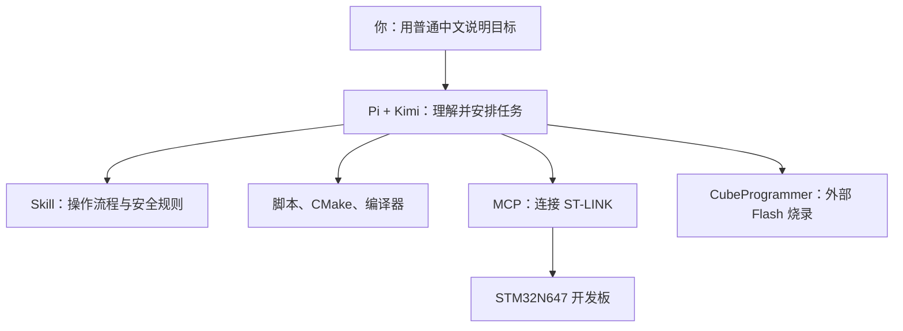

# STM32N647 MCP 与 Pi 的 16 个 Skills 初学者使用教程

> 适用对象：首次接触 AI Agent、Pi、MCP 与 Agent Skills，具备基础 STM32 开发经验，但不熟悉复杂工程术语的学习者。
>
> 适用环境：macOS、Pi CLI、Kimi for Coding、正点原子 ATK-CNN647B、STM32N647、CubeMX 原生 CMake 工程、定制 `embedded-debugger-mcp`、STM32CubeProgrammer。
>
> 教程版本：2026-07-22。本文以当前已经验收的板级地址、MCP 和 Skills 为基础；更换开发板、启动方式、外部 Flash 或工具版本后，必须重新核对相关参数。

本次结论不是“原来的三个 Skill 完全不用改”，而是先完成必要修订，再据此重写教程。`prepare-stm32n647-project` 已把固定脚本设为新工程的正常快捷路径；`debug-stm32n647-sram` 已把 LED 冻结扩展为任意崩溃、卡死或外设异常；`release-stm32n647-appli` 已改为按当前应用选择 UART、变量、GPIO、LED 等启动证据，并明确纯离线预检在缺少已封存 FSBL 板级证据时必须停止。三项 Skill 现在都接受普通中文、自动选择最低权限模式，并默认输出简短结果。

# 第一章 16 个 Skills 在 Pi 中的安装与基本原理

## 1.1 Pi、Kimi、Skill、MCP 和开发工具分别是什么

初次接触 AI Agent 时，最容易产生的误解，是把 Pi、Kimi、Skill、MCP、CMake 和调试器视为同一种工具。它们实际上处在不同层次，并承担完全不同的工作。

Pi 可以理解为运行在终端中的“AI 操作员”。它负责接收用户的自然语言任务、读取工程文件、安排操作顺序并调用本机工具。Kimi 是 Pi 当前使用的语言模型，主要负责理解用户的意思和作出判断。Skill 是写给 AI 操作员看的操作手册，其中记录了某类任务应当按什么顺序完成、哪些文件需要检查、哪些危险操作必须暂停并等待用户确认。Skill 本身不会编译代码，也不能直接连接 ST-LINK。

真正完成编译的是 CMake、Ninja 和 Arm 交叉编译器；真正完成工程整理的是 `atk_stm32n6_cmake_prepare.py`；真正完成外部 NOR Flash 烧录的是 STM32CubeProgrammer 和对应的 `.stldr` 外部加载器。MCP 则是 Pi 与调试工具之间的接口，使 Pi 能够通过 ST-LINK 查看 MCU 状态、暂停 CPU、读取寄存器以及把调试程序临时装入 SRAM。



因此，Skill 更像实验指导书，MCP 更像实验仪器，Pi 是按照指导书使用仪器和软件的操作员。用户的主要任务是说明“想做什么”和“现在是否允许碰开发板”，不需要自己编写底层调试命令。

## 1.2 本教程所说的 16 个 Skills

本教程中的 16 个 Skills 由三部分组成。

| 类别 | 数量 | Skills |
| --- | ---: | --- |
| 通用嵌入式开发 | 3 | `build-cmake`、`memory-analysis`、`serial-monitor` |
| STM32N647 专用 | 3 | `prepare-stm32n647-project`、`debug-stm32n647-sram`、`release-stm32n647-appli` |
| `pi-spec` 规格驱动开发 | 10 | `spec-driven-development`、`spec-brainstorm`、`spec-requirements`、`spec-design`、`spec-tasks`、`spec-implementation`、`spec-review`、`spec-templates`、`spec-agents`、`tdd` |

用户原清单中的 `skillispec-tasks` 是排版错误，正确名称为 `spec-tasks`。`shared` 是 `embed-ai-tool` 中供脚本共同使用的支持目录，不含自己的 `SKILL.md`，因此不算一个 Skill。

此前使用的 `https://www.skills.sh/leokemp223/embed-ai-tool/stm32-hal-development` 是旧页面。`stm32-hal-development` 曾经存在，但已于 2026 年 6 月从上游仓库删除；它既未出现在当前实际安装列表中，也不属于本文的 16 个 Skills。删除原因是它属于 STM32 知识手册型 Skill，与该仓库当前以执行脚本为核心的定位不一致。相关变更可见 [embed-ai-tool 删除提交](https://github.com/LeoKemp223/embed-ai-tool/commit/9d5b7dcfb8382e331f07b6c3f104517ed523a1f5)。

## 1.3 Pi 如何发现和使用 Skill

Pi 启动时只读取各 Skill 的名称和简短说明。当用户的任务与某个 Skill 匹配时，Pi 才按需读取完整的 `SKILL.md` 以及必要的 `references/` 或 `scripts/`。这种方式称为“按需加载”，它可以避免把 16 份完整手册同时放进模型上下文中。

Pi 官方支持以下常用位置：

```text
~/.pi/agent/skills/       用户级，仅供 Pi 使用
~/.agents/skills/        用户级，可供多个 Agent 共用
.pi/skills/              当前工程级
.agents/skills/          当前工程级，可供多个 Agent 共用
```

Pi 还可以从扩展包以及设置文件中指定的额外路径加载 Skills。完整规则见 [Pi Skills 官方文档](https://pi.dev/docs/latest/skills)。

Skill 安装后，在 Pi 中输入：

```text
/reload
```

随后输入 `/skill:` 并观察自动补全。显式调用格式为：

```text
/skill:skill-name

用普通中文说明这次想完成什么。
```

显式写出 `/skill:名称` 的作用，是强制 Pi 读取这份操作手册。斜杠命令后面的任务仍然可以使用普通中文，不需要照抄本文的专业词汇。

## 1.4 安装 `pi-spec` 提供的 10 个 Skills

`pi-spec` 是一个 Pi 扩展包，10 个 `spec-*`/`tdd` Skills 由扩展动态提供，不应逐个复制到 `~/.agents/skills/`。在普通终端中运行：

```bash
pi install npm:pi-spec
```

安装完成后进入 Pi，输入：

```text
/reload
```

然后可以通过 `/specs` 查看规格状态，也可以输入 `/spec-` 查看规格流程命令。`pi-spec` 当前的公开安装方式、10 个 Skills 和相关命令可在 [pi-spec 官方包页](https://pi.dev/packages/pi-spec) 核对。

需要注意，`tdd` 并非默认强制启用。项目的 `.specs/config.yaml` 中只有在下列配置为 `true`，或用户显式要求 TDD 时，它才应参与实现：

```yaml
principles:
  tdd: true
```

## 1.5 安装三个通用嵌入式 Skills

这三个 Skills 来自 [LeoKemp223/embed-ai-tool](https://github.com/LeoKemp223/embed-ai-tool)：

```text
build-cmake
memory-analysis
serial-monitor
```

你当前 Mac 上已经安装成功，并且 `~/.agents/skills/` 中的链接能够被 Pi 发现，因此没有必要再次安装。若日后迁移到新电脑，推荐使用仓库自己的 Python 安装器，因为它会同时安装脚本依赖的 `shared/` 目录。不要只复制三个 `SKILL.md`，也不要使用会遗漏 `shared/` 的安装方式。

首先取得仓库：

```bash
git clone https://github.com/LeoKemp223/embed-ai-tool.git
```

先列出仓库中实际存在的 Skills，确认三个名称仍然有效：

```bash
python3 embed-ai-tool/scripts/install.py --list
```

确认推荐结果后，只安装本文需要的三个 Skills：

```bash
python3 embed-ai-tool/scripts/install.py "$HOME" \
  --skills build-cmake memory-analysis serial-monitor
```

这里把 `$HOME` 作为安装目标，因此文件进入用户主目录下的 `.claude/skills/`。安装后可查看记录：

```bash
python3 embed-ai-tool/scripts/install.py "$HOME" --status
```

该方式通常会得到：

```text
~/.claude/skills/build-cmake/
~/.claude/skills/memory-analysis/
~/.claude/skills/serial-monitor/
~/.claude/skills/shared/
```

随后可保留你当前已经验证过的 `~/.agents/skills/` 符号链接；也可以在 `~/.pi/agent/settings.json` 的 `skills` 数组中加入 `~/.claude/skills`。修改设置时必须合并现有内容，不能为了增加一个路径而覆盖整个设置文件。例如：

```json
{
  "skills": ["~/.claude/skills"],
  "enableSkillCommands": true
}
```

安装后至少检查下列脚本能够显示帮助信息：

```bash
python3 ~/.claude/skills/build-cmake/scripts/cmake_builder.py --help
python3 ~/.claude/skills/memory-analysis/scripts/memory_analyzer.py --help
python3 ~/.claude/skills/serial-monitor/scripts/serial_monitor.py --help
```

如果出现 `No module named tool_config` 或 `No module named profile_store`，通常说明 `shared/` 没有与三个 Skills 放在同一父目录下。

## 1.6 安装三个 STM32N647 专用 Skills

三个专用 Skills 是本项目在通用工具之上增加的板级操作规程。它们分别负责离线工程准备、SRAM 调试以及外部 NOR Release，不能互相代替。

在 Pi 中使用时，完整目录应为：

```text
~/.agents/skills/
├── prepare-stm32n647-project/
│   ├── SKILL.md
│   └── references/
├── debug-stm32n647-sram/
│   ├── SKILL.md
│   └── references/
└── release-stm32n647-appli/
    ├── SKILL.md
    └── references/
```

三个修订版可以从你的 ChatGPT Skills 页面取得完整目录：

- [prepare-stm32n647-project](https://chatgpt.com/skills?skill_id=6a607236d7ec8191b596d1d312362ed3)
- [debug-stm32n647-sram](https://chatgpt.com/skills?skill_id=6a6072815e2c81919424696e4b67815e)
- [release-stm32n647-appli](https://chatgpt.com/skills?skill_id=6a6072c9ff1081919e95c47a3f582a95)

在一台尚未安装的新 Mac 上，先把三个完整目录下载到一个临时位置，再复制到 `~/.agents/skills/`。以下 `/下载位置/` 只是占位，必须替换成实际绝对路径：

```bash
mkdir -p ~/.agents/skills
cp -R /下载位置/prepare-stm32n647-project ~/.agents/skills/
cp -R /下载位置/debug-stm32n647-sram ~/.agents/skills/
cp -R /下载位置/release-stm32n647-appli ~/.agents/skills/
```

复制后逐项确认目标目录直接包含 `SKILL.md`，没有意外形成 `skill-name/skill-name/SKILL.md` 的双层嵌套。Pi + Kimi 只需 `SKILL.md` 与其中实际引用的 `references/`；`agents/openai.yaml` 不是 Pi 运行这三项 Skill 的必要文件。

若 Mac 上已经存在旧版，不要直接执行上述 `cp -R`，否则不同系统可能合并成双层目录或遗留旧文件。先把下载版放在临时目录，让 Pi 只读比较三个目录；确认只更新这三项 Skill 后，再用明确授权替换对应目录，最后输入 `/reload`。此步骤只更新操作手册，不应修改 MCP 配置、工程源码或其他 Skills。

你的 Mac 已经存在这三个目录。本文对应的修订版增加了“普通中文自动选择模式”和“默认简短报告”，并去除了 LED 对通用调试、烧录成功判断的绑定。更新时应替换完整 Skill 目录或按照修订版同步 `SKILL.md` 与 `references/`，不能只修改示例标题而保留旧的通用门槛。

安装或更新完成后输入 `/reload`，并确认能够自动补全：

```text
/skill:prepare-stm32n647-project
/skill:debug-stm32n647-sram
/skill:release-stm32n647-appli
```

Skill 的安装并不等于 MCP 已经连接。三个命令出现，只能证明操作规程能够被 Pi 读取。真正需要调试时，还要在 `/mcp` 中确认 `embedded-debugger` 指向已经验收的 26 工具版本。

## 1.7 最终安装检查

完成安装后，按以下顺序检查：

```text
1. 在 Pi 中输入 /reload。
2. 输入 /skill:，核对普通 Skill 命令。
3. 输入 /spec-，核对 pi-spec 命令。
4. 输入 /mcp，只查看 embedded-debugger 状态，不连接开发板。
```

16 个 Skills 不一定全部表现为 `~/.agents/skills/` 下的 16 个目录，因为 `pi-spec` 的 10 个 Skills 是由扩展动态加载的。判断是否安装成功，应以 Pi 中实际可用的 Skill/命令列表为准，而不是简单统计目录数量。

还应避免在不同位置安装多个同名副本。Pi 遇到同名 Skill 时会警告并保留先发现的版本，这可能造成“明明更新了文件，Pi 却仍在使用旧版”的现象。

## 1.8 普通提示词会不会影响 Skill 的指导作用

一般不会。你不需要知道 `PT_LOAD`、向量表、幂等、哈希前缀或最小擦除扇区。只要显式写出 `/skill:名称`，并说明目标与允许范围，Pi 就应当把普通语言翻译为专业操作。若目标确实不明确，正确行为是只问一个关键问题，而不是让你先学习完整的调试术语。

推荐的最简模板是：

```text
/skill:技能名称

我想完成：……
现在允许：只查看 / 修改工程 / 连接开发板。
结果请简短报告。真正写入 SRAM 或烧录 Flash 前先停下来让我确认。
```

例如：

```text
/skill:prepare-stm32n647-project

我刚从 CubeMX 重新生成了工程，请把它整理到能够编译 Debug。
不要连接开发板，结果简短告诉我。
```

这已经足够。Skill 会把它理解为工程准备与 Debug 构建，并在工程根目录、应用上下文或构建配置无法确定时询问你。

只有三种情况需要精确输入：其一，Pi 已展示某个具体 ELF 或 HEX 后生成的一次性授权口令；其二，工程中存在多个 `.ioc`、应用或固件文件，需要你明确选择一个；其三，物理跳线、断电上电等只能由你亲手完成的步骤。即使是授权口令，也不需要你自己计算，Pi 会给出完整文本，你核对中文摘要后复制即可。

## 1.9 常见专业词汇的初学者解释

| 专业词汇 | 初学者可以怎样理解 |
| --- | --- |
| `dry-run` | 先演练一次，只展示准备做什么；对于本项目已检查过的准备脚本，它不会真正应用工程修改。 |
| 幂等 | 同一整理脚本重复运行，第二次不会再重复追加相同内容。日常成功流程无需专门证明。 |
| 生成源 | 负责产生配置文件的脚本或模板。若 `tasks.json` 是脚本生成的，脚本才是长期修改位置。 |
| 契约一致 | 当前工程符合这块板已经验证过的地址或启动约定，并不是法律合同。 |
| `halt` | 暂停 CPU，类似给正在运行的程序按下暂停键。 |
| “停在……门” | 到达危险操作前必须停下，等待用户确认。 |
| SHA-256 / 哈希 | 文件的数字指纹，用于确认本次操作针对的到底是哪一个文件；它不能证明程序功能一定正确。 |
| 擦除扇区 | Flash 只能按固定大小的块擦除，不能随意只擦一个字节。 |
| 最小擦除扇区 | 能覆盖应用程序、同时数量最少的一组块，目的是避免擦到 FSBL。 |
| FSBL | 上电后先运行的小型启动程序，它负责继续启动真正的应用。 |
| ELF | 适合调试，包含机器代码、函数名、变量名和调试信息。 |
| HEX | 固件数据带目标地址，适合按文件地址烧录。 |
| BIN | 只有连续字节，本身不记录应烧到哪个地址。 |
| 向量表 | CPU 启动时首先读取的一张入口表，包含初始栈地址和复位入口。 |
| SRAM | 断电后内容消失的运行内存，适合临时装载 Debug 程序。 |
| 外部 NOR Flash | 断电后程序仍保留的存储器，正式 Release 程序放在这里。 |
| 地址白名单 | 事先规定的允许写入范围，防止调试程序写到错误地址。 |
| 回读验证 | 写完后再读回来，与原文件逐字节比较。 |
| 基线程序 | 已确认能正常工作的程序，用于调试失败后的恢复。 |
| 隔离构建目录 | 为本次编译单独建立的目录，避免覆盖旧产物或混入旧目标文件。 |
| BSP | 针对具体开发板的驱动和引脚封装，例如正点原子对板载 LED、按键、HyperRAM 等外设的代码。 |

## 1.10 什么时候不必使用完整的 Spec 流程

`pi-spec` 的审批门是有意设计的：需求、设计和任务必须分别确认，避免 AI 从一个模糊想法直接修改大量代码。但它并不适合所有练习。若任务只是修改一个 GPIO、调整一次串口波特率或修复一个明确的编译错误，直接调用相应的工程或调试 Skill 通常更高效。

当功能包含多个外设、状态机、故障策略、AI 推理、通信协议或需要论文级可追溯记录时，再使用完整的 `brainstorm → requirements → design → tasks → implementation → review` 流程。

# 第二章 `spec-driven-development`

## 2.1 作用

`spec-driven-development` 是整个规格驱动开发流程的总控 Skill。它规定新功能的文档统一放在 `.specs/<feature-slug>/` 下，并要求按照“先理解问题、再写需求、再做设计、再拆任务、最后实现”的顺序推进。它最重要的作用不是替用户写更多文档，而是防止 AI 在需求仍然含糊时直接开始改代码。

每个功能通常对应：

```text
.specs/<feature-slug>/
├── brainstorm.md
├── requirements.md
├── design.md
└── tasks.md
```

本 Skill 有五个正式阶段。每个阶段都需要单独确认；用户说一次“继续”只批准当前阶段，不能自动批准后面的全部阶段。

## 2.2 第一阶段：brainstorm

### 功能

该阶段澄清用户真正想解决的问题、使用者、范围、限制、风险和成功标准。Pi 一次只问一个最重要的问题，最后形成简短的 `brainstorm.md`。

### 使用场景

适合“我想做一个电池状态监测功能，但具体怎么做还没想清楚”这类目标明确、方案尚不清楚的任务。不适合已经定位到某一行的简单编译错误。

### 初学者可以这样说

```text
/spec-brainstorm battery-monitor

我想让 STM32N647 定时读取电池数据并通过串口输出。
我是初学者，请一次只问我一个问题，并优先选择最简单可靠的方案。
```

## 2.3 第二阶段：requirements

### 功能

该阶段把讨论结果整理为可测试的需求，使用 `FR-001`、`NFR-001` 等稳定编号，并明确系统在某个条件下“必须”产生什么行为。文档在审批前保持 `requirements-draft`。

### 使用场景

适合明确采样周期、输出字段、异常处理、精度、性能和安全要求，使后续设计不会凭空增加或遗漏功能。

### 初学者可以这样说

```text
/spec-requirements battery-monitor

根据已经确认的 brainstorm 写需求。请把采样、串口输出、传感器异常和超时
写成能实际测试的要求，写完后停下来让我检查。
```

## 2.4 第三阶段：design

### 功能

该阶段在需求被批准后设计代码结构、数据流、外设接口、错误恢复、测试方法和回滚方式，并说明每一个需求由哪一项设计满足。

### 使用场景

适合决定“哪些逻辑放在 BSP、哪些放在用户模块、定时器中断只做什么、主循环处理什么、如何避免阻塞”等技术问题。

### 初学者可以这样说

```text
/spec-design battery-monitor

需求已经确认。请结合当前 STM32N647 工程设计最简单的模块结构，说明
CubeMX 配置、BSP 调用、定时器、串口和错误处理，但现在不要写代码。
```

## 2.5 第四阶段：tasks

### 功能

该阶段把设计拆成按顺序执行的小任务，每个任务带复选框、对应需求编号、可能涉及的文件以及验证方法。任务在用户批准前保持 `tasks-draft`。

### 使用场景

适合把“配置 CubeMX、接入 BSP、实现采样、输出串口、处理故障、验证 SRAM 运行”等工作拆开，避免 AI 一次修改整个工程。

### 初学者可以这样说

```text
/spec-tasks battery-monitor

把已批准的设计拆成小任务。每个任务告诉我会改哪里、怎样验证；
先给任务清单，不要开始实现。
```

## 2.6 第五阶段：implementation

### 功能

该阶段只有在 `tasks.md` 被明确批准并通过实现前检查后才能开始。Pi 按任务顺序修改代码、运行验证并勾选任务；若实际工程与设计冲突，应先更新设计并解释原因。

### 使用场景

适合正式执行已经审查的功能计划。若只是临时试验一个 HAL API，可以不走完整五阶段。

### 初学者可以这样说

```text
/spec-implement battery-monitor

任务清单已经批准。先只完成第一个任务，验证通过后简短报告，
不要一次把后面的任务全部做完。
```

# 第三章 `spec-brainstorm`

## 3.1 作用

`spec-brainstorm` 专门负责“在写需求前把问题想清楚”。它与普通聊天的区别在于，最终讨论结果会形成可继续使用的 `brainstorm.md`，并成为需求、设计和实现共同参考的起点。该 Skill 没有命令行意义上的正式模式，以下按照三种常见用法说明。

## 3.2 第一种用法：澄清一个新功能

### 功能

Pi 识别用户目标、使用者、输入输出、约束、风险和成功标准，一次只提出一个高价值问题，避免一次抛出十几个专业问题。

### 使用场景

当你只知道“我要做什么”，却不知道采样周期、外设接口、故障策略或验收方式时使用。

### 初学者可以这样说

```text
/spec-brainstorm load-prediction-input

我想在开发板上采集一组数据，之后送给 AI 模型使用。
请一次问我一个问题，把我没考虑到的输入、输出和异常情况补齐。
```

## 3.3 第二种用法：整理一个已经讨论过但仍混乱的想法

### 功能

Pi 读取现有说明、代码或讨论记录，区分已经确定的事实、暂时假设、明确不做的范围和仍需回答的问题。

### 使用场景

适合导师、同学和自己提出了不同方案，信息很多但相互矛盾时。它可以在开始写需求前先消除冲突。

### 初学者可以这样说

```text
/spec-brainstorm battery-fault-warning

请根据当前工程和我的说明整理这个功能。先区分“必须做”“以后再做”和
“目前没有数据不能确定”的部分，不要开始写实现。
```

## 3.4 第三种用法：形成 Brainstorm Summary 并建立规格骨架

### 功能

当信息足够时，Pi 输出用户意图、范围、非范围、风险、方案、假设和建议的短名称，并询问是否建立 `.specs/<feature>/`。只有用户批准后才应写入文件。

### 使用场景

适合完成讨论并准备进入正式需求阶段。若 Pi 尚未问清最关键问题，不应为了追求速度跳过这一门槛。

### 初学者可以这样说

```text
请把刚才的讨论整理成 Brainstorm Summary。若仍有会改变方案的关键问题，
继续一次问一个；否则先让我确认，再建立规格目录。
```

# 第四章 `spec-requirements`

## 4.1 作用

`spec-requirements` 把用户目标变成可验证的需求文件。它关注“系统必须表现成什么样”，而不是“具体代码如何写”。好的需求应当使测试者能够判断通过或失败，不能只写“程序要稳定”“性能要好”等无法衡量的句子。

## 4.2 第一种用法：首次起草需求

### 功能

Pi 读取 `brainstorm.md`，建立范围、用户故事、功能需求 `FR-*`、非功能需求 `NFR-*`、验收标准、边界情况和待确认问题。

### 使用场景

适合一个中等或复杂新功能正式进入设计前。例如定义 ADC 采样、数据滤波、串口帧和传感器失效行为。

### 初学者可以这样说

```text
/spec-requirements battery-monitor

根据 brainstorm 起草需求。请使用能测试的说法，不要提前决定代码文件或函数名。
```

## 4.3 第二种用法：补全含糊或不可测试的需求

### 功能

Pi 检查诸如“快速”“及时”“尽量不丢数据”等词，询问或记录可量化标准；同时补充权限、数据保存、超时、重试、兼容性和性能等容易遗漏的内容。

### 使用场景

适合已有一份需求草稿，但导师或团队认为它太宽泛，无法直接据此做设计和测试时。

### 初学者可以这样说

```text
/skill:spec-requirements

检查 battery-monitor 的 requirements.md，找出不能直接测试的句子。
一次只问我一个会真正改变需求的问题，不要开始设计。
```

## 4.4 第三种用法：需求审批

### 功能

需求起草完成后，状态保持 `requirements-draft`。用户明确批准后，Pi 才将其改为 `requirements-approved`，并询问是否开始设计。一次“批准”只批准需求，不同时批准设计和任务。

### 使用场景

适合用户已经逐项检查范围、编号与验收标准，确认没有漏项或擅自扩展时。

### 初学者可以这样说

```text
我批准当前 battery-monitor 的 requirements.md。请只更新需求状态，
告诉我下一步是什么；现在不要写 design.md。
```

# 第五章 `spec-design`

## 5.1 作用

`spec-design` 在需求被批准之后，说明系统将如何实现。对于 STM32 工程，它不仅要考虑普通代码结构，还应区分 CubeMX 硬件配置、HAL 初始化、正点原子 BSP、用户业务逻辑、中断上下文、DMA 缓冲区和可在主机上测试的纯软件逻辑。

## 5.2 第一种用法：设计总体结构

### 功能

Pi 设计模块边界、数据流、API、配置、状态机、错误处理、安全、测试、迁移和回滚，并说明关键取舍。

### 使用场景

适合多个外设共同工作的功能，或代码可能跨越 `main.c`、用户模块、BSP 和中断回调时。

### 初学者可以这样说

```text
/spec-design battery-monitor

请基于已批准需求设计模块结构。CubeMX 负责硬件配置，BSP 负责板级驱动，
用户模块负责业务逻辑；不要把大量业务处理放在中断里。
```

## 5.3 第二种用法：建立需求追踪与验证方法

### 功能

Pi 为每个 `FR-*` 和 `NFR-*` 指定对应设计以及验证方式。若某项需求无法实现，必须明确标为阻塞或提出需求变更，而不能静默删除。

### 使用场景

适合论文、课程设计或团队项目，需要说明“这一项需求由哪部分设计满足、最终怎样证明”的任务。

### 初学者可以这样说

```text
/skill:spec-design

检查 battery-monitor 的每个需求是否都有设计和验证方法。
重点说明哪些能在电脑上测试，哪些必须上开发板验证。
```

## 5.4 第三种用法：设计审批

### 功能

设计在审查期间保持 `design-draft`。用户明确批准后才改为 `design-approved`，之后才能开始拆任务。

### 使用场景

适合确认架构、外设配置、错误策略和测试方法均合理之后。若你还不理解某个设计，应该先要求 Pi 用白话解释，不必勉强批准。

### 初学者可以这样说

```text
我批准当前 battery-monitor 的 design.md。请只更新设计状态，
不要在同一轮生成 tasks.md。
```

# 第六章 `spec-tasks`

## 6.1 作用

`spec-tasks` 把已经批准的需求和设计转换为可以逐项执行的实现清单。任务不是简单的待办事项，而是需求、文件和验证之间的连接点。每个任务都应足够小，能够在一次专注的编码过程中完成，并在完成后通过命令或人工步骤验证。

## 6.2 第一种用法：把设计拆成小任务

### 功能

Pi 按照基础配置、核心行为、集成、异常处理、测试和文档的顺序拆分任务。每项任务使用复选框，并记录 `FR-*`/`NFR-*`、可能修改的文件和验证方法。

### 使用场景

适合一个功能需要 CubeMX 配置、BSP 集成、业务代码、串口输出和实板验证等多个步骤，不能一次性安全完成时。

### 初学者可以这样说

```text
/spec-tasks battery-monitor

请把设计拆成每次只完成一小部分的任务。先配置和编译，再实现纯软件逻辑，
最后才做实板验证；现在不要写代码。
```

## 6.3 第二种用法：检查任务的顺序和可验证性

### 功能

Pi 检查每个需求是否至少由一个任务覆盖、每个任务是否有验证方式，以及风险较高的环节是否被安排在足够早的位置暴露问题。

### 使用场景

适合任务列表已经存在，但其中出现“完成整个模块”这样过大的任务，或存在只有编码动作、没有验收方法的任务。

### 初学者可以这样说

```text
/skill:spec-tasks

审查 battery-monitor 的 tasks.md。把过大的任务拆小，并确保每项都写明
怎样判断完成；不要改变已批准的需求范围。
```

## 6.4 第三种用法：任务计划审批

### 功能

任务列表在审查期间保持 `tasks-draft`。用户批准后，Pi 将状态更新为 `tasks-approved`，并执行实现前验证；只有验证通过，才允许修改源代码。

### 使用场景

适合用户确认任务没有漏项、顺序合理、验证成本可接受之后。批准任务并不意味着授权烧录 Flash，硬件写入仍由板级 Skill 单独控制。

### 初学者可以这样说

```text
我批准 battery-monitor 的 tasks.md。请更新状态并做实现前检查；
检查通过后先停下来，不要立刻修改代码。
```

# 第七章 `spec-templates`

## 7.1 作用

`spec-templates` 提供 `brainstorm.md`、`requirements.md`、`design.md` 和 `tasks.md` 的标准结构。它的目标是保证重要章节不会因为每次由 AI 临时设计格式而遗漏。该 Skill 没有正式模式，以下按“创建”和“修复”两种常见用法说明。

## 7.2 第一种用法：创建规格文件骨架

### 功能

Pi 使用 `pi-spec` 自带模板填入功能短名称、标题、说明、摘要和日期。若扩展提供 `spec_init`，应优先使用该工具，而不是手工拼接四个文件。

### 使用场景

适合 brainstorm 已获批准，准备为新功能创建 `.specs/<feature>/` 时。

### 初学者可以这样说

```text
/skill:spec-templates

battery-monitor 的 brainstorm 已经批准。请用当前 pi-spec 模板创建规格骨架，
保留草稿状态，只开始填写 requirements.md。
```

## 7.3 第二种用法：修复已有规格结构

### 功能

Pi 将模板中缺失的章节补入已有文件，同时保留用户写过的内容、需求编号和任务编号。它不应为了“看起来整齐”而重写已经批准的结论。

### 使用场景

适合旧规格缺少状态行、追踪表、非目标或验证章节，导致新版本 `pi-spec` 无法正常检查时。

### 初学者可以这样说

```text
/skill:spec-templates

修复 battery-monitor 规格文件的结构，只补缺少的模板章节。
保留现有文字、FR/NFR 编号和任务编号，不要重新写整份文档。
```

# 第八章 `spec-agents`

## 8.1 作用

`spec-agents` 说明如何把规格流程中的部分工作交给可选子代理，例如让一个代理专门审查需求、另一个代理检查设计追踪。它不是核心流程的必需组件；只有安装了 `pi-subagents`，或用户明确希望使用多个代理时才有意义。

## 8.2 第一种用法：安装可选规格子代理

### 功能

Pi 通过 `/spec-install-agents` 将包内的五个代理定义复制到当前工程的 `.pi/agents/`。只有显式添加 `--force` 才能覆盖已有同名文件。

### 使用场景

适合较大项目需要独立的 brainstorm、requirements、design、task-planner 和 review 角色。普通课程练习通常不需要安装。

### 初学者可以这样说

```text
/skill:spec-agents

先检查当前工程是否已经安装 pi-subagents，并列出准备安装的规格代理。
不要使用 --force，也不要覆盖已有代理文件。
```

## 8.3 第二种用法：把审查工作交给子代理

### 功能

主代理保留最终决策权，子代理只进行专项分析、起草或复核。多个代理不应同时编辑同一个规格文件，否则容易互相覆盖。

### 使用场景

适合让独立代理检查需求是否可测试，或检查设计是否遗漏某些需求，而主代理继续负责和用户沟通。

### 初学者可以这样说

```text
/skill:spec-agents

让一个规格审查代理只读检查 battery-monitor 的需求和设计追踪，
主代理负责汇总结论。不要让多个代理同时修改文件。
```

## 8.4 第三种用法：不使用子代理

### 功能

当项目规模较小、任务明确或用户希望节省 token 时，主代理可以独立完成整个规格流程。`spec-agents` 不应因为已经安装就自动增加代理数量。

### 使用场景

适合单个外设功能、短期课程作业或一次简单重构。此时可以明确要求“本任务不启用子代理”。

### 初学者可以这样说

```text
这个功能较小，请由当前 Pi 会话完成，不启用规格子代理，报告保持简短。
```

# 第九章 `tdd`

## 9.1 作用

`tdd` 指导 Pi 使用“红—绿—重构”方式开发：先写一个会失败的测试，再写刚好让它通过的最小实现，最后在所有测试仍通过的前提下整理代码。它适合验证纯软件行为，例如数据滤波、状态机、阈值判断、协议解析和能量管理算法；它不能证明真实引脚、电气连接、中断时序、DMA 或外部器件一定正确。

## 9.2 第一阶段：规划一个纵向小切片

### 功能

Pi 重新读取本任务对应的需求，选择一个能够通过公共接口观察的行为，并决定最小测试边界。测试关注“系统做了什么”，而不是检查私有函数内部如何实现。

### 使用场景

适合实现“输入一组采样值后应输出滤波结果”或“超过温度阈值后状态机进入警告状态”等逻辑。

### 初学者可以这样说

```text
/skill:tdd

为电池温度阈值判断选择第一个最小行为。先告诉我要验证什么公共输入输出，
不要一次列出所有测试，也不要先写实现。
```

## 9.3 第二阶段：RED——写一个失败测试

### 功能

Pi 只写一个测试，并确认该测试在新功能尚未实现时确实失败。如果测试一开始就通过，说明它可能没有覆盖新行为或现有代码已经实现了目标。

### 使用场景

适合建立功能的第一条可执行证据。对于必须在板上才能发生的硬件中断，不应伪造一个主机测试来声称硬件已经通过。

### 初学者可以这样说

```text
先只写一个测试：当温度达到阈值时返回 warning。
运行它并确认失败，暂时不要写生产代码。
```

## 9.4 第三阶段：GREEN——最小实现

### 功能

Pi 只增加足以让当前测试通过的代码，不提前实现尚未测试的功能。测试通过后再进入下一条行为。

### 使用场景

适合控制 AI 的修改范围，避免一次加入大量未验证分支。

### 初学者可以这样说

```text
现在写让这一条测试通过的最小代码。通过后停止，不要提前实现滞回或故障恢复。
```

## 9.5 第四阶段：逐条增加行为

### 功能

Pi 重复“一条失败测试 → 对应最小实现”的纵向循环，而不是先把所有测试一次写完、再集中写全部代码。

### 使用场景

适合逐步增加正常、边界、异常和恢复行为，并利用上一轮结果修正下一轮测试设计。

### 初学者可以这样说

```text
继续下一条行为：温度低于恢复阈值后退出 warning。
仍然只做一个测试和对应实现。
```

## 9.6 第五阶段：REFACTOR——重构

### 功能

所有当前测试通过后，Pi 才消除重复、改善接口和模块边界，并在每次重构后重新运行测试。测试失败时禁止同时大改结构。

### 使用场景

适合功能已经正确但代码重复、接口过于复杂或模块职责不清时。

### 初学者可以这样说

```text
当前测试都通过了。请只做不改变外部行为的重构，每一步后重新运行测试。
```

## 9.7 第六阶段：关闭任务

### 功能

Pi 在验证通过后更新 `tasks.md`，记录实际测试命令并勾选任务。无法运行验证时，不得把任务标记为完成。

### 使用场景

适合一项算法或业务逻辑完成，需要保留从需求到测试的证据时。

### 初学者可以这样说

```text
请记录本任务实际运行的测试命令和结果，再更新 tasks.md。
若有测试没运行，保持任务未完成并说明原因。
```

# 第十章 `spec-implementation`

## 10.1 作用

`spec-implementation` 负责执行已经批准的 `tasks.md`。它管理任务顺序、实现状态、验证结果和复选框，而 `tdd` 只在启用时规定每项任务内部如何写代码。两者可以协作，但职责不同。

## 10.2 第一种用法：实现前检查

### 功能

Pi 读取 brainstorm、requirements、design 和 tasks，确认任务不再处于 `tasks-draft`，然后执行 `spec_validate`。只有状态和追踪关系都合格，才把工作状态推进到 `implementation-in-progress`。

### 使用场景

适合正式开始一个中等或复杂功能，防止 AI 跳过尚未批准的设计。

### 初学者可以这样说

```text
/spec-implement battery-monitor

先做实现前检查并报告是否可以开始。若规格状态不正确，只告诉我缺什么，
不要修改源代码。
```

## 10.3 第二种用法：按顺序完成一个任务

### 功能

Pi 一次完成一个任务或一小组强相关任务，修改代码、运行验证，并仅在验证成功后勾选复选框。

### 使用场景

适合控制每轮改动范围。例如先接入一个 BSP 模块并保证能编译，再实现业务逻辑。

### 初学者可以这样说

```text
/spec-implement battery-monitor

只完成 T-001。调用正点原子 BSP 前先读取真实头文件和参考例程，
验证通过后更新任务；不要自动继续 T-002。
```

## 10.4 第三种用法：处理设计与实际工程的冲突

### 功能

若实际 BSP API、CubeMX 结构或硬件资源与设计不同，Pi 应先说明差异并更新 `design.md`，不能一边偏离设计、一边仍声称完全按规格实现。

### 使用场景

适合发现预想函数不存在、DMA 通道冲突、某个外设实例已被占用等情况。

### 初学者可以这样说

```text
实际 BSP 没有设计中写的函数。请先查真实头文件和例程，说明需要怎样调整设计；
在我确认设计变更前，不要编造空函数或继续实现。
```

## 10.5 第四种用法：完成整个实现

### 功能

所有任务均完成并验证后，Pi 将状态更新为 `implementation-complete`，总结完成的任务、修改文件、验证结果和残留风险。

### 使用场景

适合功能代码已经完成，但在进入实板 Release 之前还需要一次完整状态检查。`implementation-complete` 不等于外部 Flash 已安全烧录。

### 初学者可以这样说

```text
检查 battery-monitor 是否所有任务都真正验证过。只有全部通过才更新为
implementation-complete；SRAM 调试和 Flash 烧录仍留给专用 Skill。
```

# 第十一章 `spec-review`

## 11.1 作用

`spec-review` 负责审查规格自身的质量以及代码是否偏离规格。它通常只读，不负责顺手重写所有文件。审查结果按 Blockers、Risks 和 Suggestions 分级，使用户能够先处理会阻止下一阶段的问题。

## 11.2 第一种用法：审查规格完整性

### 功能

Pi 检查 brainstorm 是否充分、需求是否可测试且有编号、设计是否覆盖需求、任务是否有验证方法以及是否存在会阻止实现的未决问题。

### 使用场景

适合需求、设计或任务刚完成，希望在批准前让独立视角检查遗漏。

### 初学者可以这样说

```text
/spec-review battery-monitor

只审查 brainstorm、requirements、design 和 tasks 的一致性。
按阻塞问题、风险和建议输出，不修改文件。
```

## 11.3 第二种用法：审查实现漂移

### 功能

Pi 将已完成任务对应的代码和测试与需求、设计进行比较，查找未写入规格的新行为、被遗漏的功能、无验证证据的已勾选任务和错误处理缺口。

### 使用场景

适合实现过程中做过临时调整，担心最终代码与原先设计不一致时。

### 初学者可以这样说

```text
/spec-review battery-monitor

检查当前实现是否偏离已批准规格。重点看 BSP API、故障处理、测试证据，
以及 CubeMX 重新生成后用户代码是否会丢失。先只报告，不修复。
```

## 11.4 第三种用法：形成分级审查结果

### 功能

Blocker 表示下一阶段前必须解决；Risk 表示应修复或由用户明确接受；Suggestion 只是可选改进。每个问题应指出文件路径和需求/任务编号，避免只有笼统评价。

### 使用场景

适合将审查结果交给同学、导师或另一个 Agent 继续处理。

### 初学者可以这样说

```text
请把审查结果限制为最重要的内容：先列所有 Blockers，再列最多五项 Risks，
Suggestions 只保留会明显提高可靠性的项目。
```

# 第十二章 `build-cmake`

## 12.1 作用

`build-cmake` 是通用的嵌入式 CMake 构建 Skill。它通过自带的 `cmake_builder.py` 检查 CMake、Ninja、工具链和预设，完成配置与编译，并定位 ELF、HEX 和 BIN。它不天然知道正点原子 STM32N647 的板级安全规则，因此在本项目中，普通工程初始化优先使用 `prepare-stm32n647-project`；只有遇到通用 CMake 问题、需要单独扫描产物或进行更底层的构建控制时，再直接调用本 Skill。

成功构建后，该脚本默认会在工程根目录保存 `.em_skill.json`，以便下次复用构建参数。因此，“只读检查”时应明确要求不保存 profile，不能把它误认为绝对不写文件的工具。

## 12.2 第一种模式：缓存自动复用

### 功能

脚本自动读取上一次成功构建保存的源码目录、构建目录、预设、生成器、构建类型、工具链和目标。`--resume` 主要用于要求“必须存在缓存”，而不是每次正常构建都必须添加。

### 使用场景

适合同一个工程在下一次 Pi 会话中继续编译，且工程结构、工具链和目标均未改变。

### 初学者可以这样说

```text
/skill:build-cmake

继续使用这个工程上次成功的 Debug 构建配置，重新编译并简短报告。
如果缓存不存在或目标已经变化，不要猜，先告诉我。
```

## 12.3 第二种模式：环境探测

### 功能

只检查 `cmake`、Ninja/Make、Arm 编译器和必要工具是否存在，不编译程序。底层对应 `--detect`。

### 使用场景

适合新电脑、工具链刚更新或 VS Code 能打开工程但无法配置时。

### 初学者可以这样说

```text
/skill:build-cmake

只检查当前电脑的 CMake、Ninja 和 STM32 Arm 编译器是否可用。
不要生成 build 目录，也不要保存 profile。
```

## 12.4 第三种模式：使用 CMake Preset 构建

### 功能

Skill 读取 `CMakePresets.json`，列出可用预设并使用用户选择的 Debug 或 Release 配置。它不应在已有明确预设时擅自改用 `RelWithDebInfo`。

### 使用场景

适合 CubeMX 已生成 Debug/Release preset，或项目团队已经固化编译参数时。

### 初学者可以这样说

```text
/skill:build-cmake

列出当前工程已有的 CMake presets，并使用明确名为 Debug 的配置构建。
不要改成 RelWithDebInfo，不要连接开发板。
```

## 12.5 第四种模式：手动指定构建配置

### 功能

当工程没有 preset 时，可以明确指定源码目录、构建目录、Ninja、Debug/Release 和工具链文件。

### 使用场景

适合旧工程、非标准 CMake 工程，或生成文件不完整但 CMakeLists 与工具链文件仍可用时。

### 初学者可以这样说

```text
/skill:build-cmake

当前工程没有 preset。请先只读找出源码目录、工具链和可用构建类型，
把准备执行的配置命令解释给我；确认前不要构建。
```

## 12.6 第五种模式：指定构建目标

### 功能

通过目标名只构建一个 target，而不是构建整个工程中的所有镜像。

### 使用场景

适合工程同时含有 Appli、FSBL、测试程序或多个应用上下文。若存在多个合理目标，Skill 必须询问，不能根据文件名猜测。

### 初学者可以这样说

```text
/skill:build-cmake

这个工程有多个 target。只列出候选并解释它们，不要编译；
我选择后再只构建 Appli。
```

## 12.7 第六种模式：只扫描已有产物

### 功能

不进行编译，只在指定构建目录中寻找 ELF、HEX 和 BIN，并按用途整理路径。底层对应 `--scan-artifacts`。

### 使用场景

适合已有构建结果，需要把 ELF 交给内存分析或 SRAM 调试，但不希望重新编译时。

### 初学者可以这样说

```text
/skill:build-cmake

只扫描当前 Debug 构建目录中的已有产物，告诉我唯一的 ELF 在哪里。
不要编译，不要修改 profile，也不要因为找到多个文件就随便选一个。
```

## 12.8 第七种模式：清理后重建

### 功能

清除指定 CMake 构建目录中的缓存后重新配置和编译。此操作会删除构建产物，但不应删除源码或整个工程。

### 使用场景

只适合已经证明构建缓存损坏、工具链切换后旧对象不兼容，或用户明确要求干净重建。普通编译失败不应第一反应就清空目录。

### 初学者可以这样说

```text
/skill:build-cmake

先证明失败是旧构建缓存造成的，并告诉我准备清理的完整构建目录。
不要删除源码；得到我确认后才进行 clean rebuild。
```

## 12.9 在 STM32N647 项目中的边界

该 Skill 的原始说明会在成功后推荐 `flash-openocd` 或 `debug-gdb-openocd`。对当前正点原子 STM32N647 工具链，不应采纳这一通用建议。SRAM 调试应交给 `debug-stm32n647-sram` 与定制 MCP；外部 NOR Flash 应交给 `release-stm32n647-appli` 与 CubeProgrammer `.stldr`。通用 OpenOCD 路线可能绕过已经建立的地址白名单、FSBL 保护和授权门。

# 第十三章 `memory-analysis`

## 13.1 作用

`memory-analysis` 完全在电脑上分析 MAP、ELF 和链接脚本，计算 `.text`、`.rodata`、`.data`、`.bss` 等段的大小，列出占空间最大的函数或变量，并比较两次构建的内存变化。它不连接开发板，也不修改固件。

该 Skill 不是每次编译都必须运行。只有程序接近内存上限、链接失败、外部 RAM 使用异常、引入 AI 模型后体积明显增加或需要论文数据时，才值得使用。

## 13.2 第一种模式：工具探测

### 功能

检查 `arm-none-eabi-size`、`arm-none-eabi-readelf` 等 ELF 分析工具是否可用。MAP 文件解析主要使用 Python，不一定依赖外部工具。

### 使用场景

适合第一次使用内存分析，或 ELF 分析提示缺少工具时。

### 初学者可以这样说

```text
/skill:memory-analysis

只检查内存分析需要的工具是否安装，不分析固件，也不修改工程。
```

## 13.3 第二种模式：扫描构建目录

### 功能

自动寻找构建目录中的 MAP 和 ELF，列出候选文件但不在多个候选之间静默猜测。

### 使用场景

适合不知道构建产物具体位于哪个子目录时。

### 初学者可以这样说

```text
/skill:memory-analysis

扫描刚才的 Debug 构建目录，列出可分析的 MAP 和 ELF。
如果有多个版本，先让我选择，不要混合分析。
```

## 13.4 第三种模式：分析 MAP

### 功能

从链接器 MAP 文件读取内存区域、段和符号，并可结合链接脚本计算使用率、设置告警阈值和输出 Top-N 大符号。

### 使用场景

适合查找“为什么 RAM 突然多了几十 KB”或“哪个模型权重、缓冲区、函数最占空间”。

### 初学者可以这样说

```text
/skill:memory-analysis

分析当前 Release 的 MAP 和对应链接脚本。简短告诉我各内存区使用率，
并列出最大的五个函数或变量；不要一次输出几十项。
```

## 13.5 第四种模式：分析 ELF

### 功能

使用 Arm 工具读取 ELF 的段大小与地址。与 MAP 相比，ELF 更接近最终调试产物，但有些符号和区域解释仍需结合链接脚本。

### 使用场景

适合只有 ELF、MAP 缺失，或需要确认主要代码实际链接到哪个地址区域时。

### 初学者可以这样说

```text
/skill:memory-analysis

只分析这个唯一的 Release ELF，检查代码和数据是否落在预期的 ROM、RAM、
EXTRAM 区域。发现异常地址时解释原因，不要修改链接脚本。
```

## 13.6 第五种模式：比较两个版本

### 功能

对比两份 MAP 中各段和符号的增减，识别某次改动造成的 Flash/RAM 膨胀。

### 使用场景

适合加入 AI 模型、通信栈或大型 BSP 前后评估资源变化，或在论文中形成定量对比。

### 初学者可以这样说

```text
/skill:memory-analysis

比较修改前后的两份 MAP。告诉我 Flash 和 RAM 分别增加多少，
以及贡献最大的五个符号；不要把地址变化误当成大小变化。
```

# 第十四章 `serial-monitor`

## 14.1 作用

`serial-monitor` 负责列出串口、选择端口、按指定波特率读取日志、等待关键字符串、持续监视并保存日志。当前脚本只接收数据，不能向开发板发送串口命令。它能从串口文本中初步识别错误、断言、重复复位和外设超时，但不能直接读取 CPU 寄存器，也不能替代 `debug-stm32n647-sram`。

该 Skill 的脚本依赖 `pyserial`。若缺失，应让 Pi 说明将执行的安装命令和作用范围，再决定是否安装。

## 14.2 第一种模式：列出或自动选择串口

### 功能

列出 macOS 上可见的串口，或根据 CH340、CP210x、CMSIS-DAP、ST-LINK 等特征选择最可能的设备。若多个候选同样合理，必须让用户选择。

### 使用场景

适合开发板刚连接、用户不知道 `/dev/cu.*` 中哪一个是目标串口时。

### 初学者可以这样说

```text
/skill:serial-monitor

列出当前 Mac 上的串口并告诉我哪个最可能属于开发板。
如果不确定，不要自动打开，先让我选择。
```

## 14.3 第二种模式：定时抓取日志

### 功能

在指定时间内读取串口并结束，适合得到短而固定的运行片段。可指定端口、波特率和时长。

### 使用场景

适合确认程序是否周期输出、是否反复复位，或截取一次错误信息。

### 初学者可以这样说

```text
/skill:serial-monitor

使用我刚确认的串口和 115200 波特率读取 10 秒。
最后只总结错误、警告和关键状态，不要把全部重复日志贴出来。
```

## 14.4 第三种模式：等待关键字符串

### 功能

持续读取直到出现指定文本或超时，例如 `Application started`、`ERROR` 或某个测试完成标志。

### 使用场景

适合把串口输出作为启动或功能验收条件。

### 初学者可以这样说

```text
/skill:serial-monitor

等待串口出现 Application started，最长等待 15 秒。
若超时，保留已收到的日志并分析最可能原因。
```

## 14.5 第四种模式：持续监视

### 功能

持续显示日志直到用户按 `Ctrl+C`，并可为每行添加时间戳。

### 使用场景

适合较长时间观察状态变化、通信过程或偶发错误。它会占用当前终端，应明确如何退出。

### 初学者可以这样说

```text
/skill:serial-monitor

持续监视这个串口并加时间戳。我按 Ctrl+C 时正常结束，
结束后总结异常，不要把 Ctrl+C 当作程序故障。
```

## 14.6 第五种模式：保存日志

### 功能

将串口内容保存到指定文件，可与定时抓取、等待字符串或持续监视组合使用。

### 使用场景

适合课程报告、论文实验、故障复现和后续交给另一个 Agent 分析。

### 初学者可以这样说

```text
/skill:serial-monitor

抓取 60 秒串口日志并加时间戳，保存到 reports/serial-run-01.log。
不要覆盖同名旧文件；结束后给我简短摘要。
```

## 14.7 第六种模式：先监听，再由用户手动复位

### 功能

脚本先打开串口，提示用户按开发板实体 RESET 或按当前板级流程操作，随后记录最早的启动日志。这样可以避免复位后才打开串口而漏掉前几行。

### 使用场景

适合捕获上电或复位初期日志。对于需要完整断电上电才能成立的 Flash boot 验收，必须按 Release Skill 的物理流程执行，不能把普通 RESET 当作等价替代。

### 初学者可以这样说

```text
/skill:serial-monitor

先打开串口等待，我看到提示后亲手按实体 RESET。
记录最早 5 秒启动日志；不要由软件自动复位开发板。
```

## 14.8 第七种模式：通过 OpenOCD 自动复位

### 功能

原始通用 Skill 可以在已经明确 OpenOCD 配置时自动复位目标，然后捕获日志。

### 使用场景

该模式适用于已验证的通用开发板流水线，但在当前 STM32N647 项目中默认禁用。它可能绕过本项目对物理复位、MCP 会话和外部 Flash 启动证据的区分。只有用户明确授权、当前板级 OpenOCD 路径已单独验证且任务不属于 Release 验收时，才可考虑使用。

### 初学者可以这样说

```text
/skill:serial-monitor

不要使用 OpenOCD 自动复位。只打开串口并提示我何时手动操作开发板。
```

## 14.9 串口异常应交给哪个 Skill

若日志已经明确显示某项应用错误，可先修复对应代码；若串口突然停止、出现 HardFault、程序卡死或变量不再更新，应把首次现场交给 `debug-stm32n647-sram`。不要按照通用 Skill 的建议切换到 `debug-gdb-openocd`，因为本项目已经建立了更适合 STM32N647 的定制 MCP 调试路线。

# 第十五章 `prepare-stm32n647-project`

## 15.1 作用

`prepare-stm32n647-project` 负责把正点原子的 STM32N647 CubeMX/CMake 工程整理到“能够检查、能够编译”的状态。它只处理电脑上的工程文件，不连接开发板，也不读写 SRAM 或 Flash。

可以把它理解成工程开工前的整理员。CubeMX 重新生成代码后，原厂生成的 CMake 文件未必自动包含正点原子 BSP、Debug/Release 链接脚本、VS Code 构建任务等项目专用内容。固定脚本 `atk_stm32n6_cmake_prepare.py` 才是完成这些常规整理工作的程序；Skill 的职责是判断当前工程适合执行什么、调用该脚本、在失败时找原因，并在最后检查结果。

因此，你对“修复脚本名不值得每次消耗 Tokens”的判断是正确的。脚本名修复只应是旧工程损坏时的特殊诊断，不应成为正常流程。修改后的 Skill 已采用以下原则：

- 新工程或 CubeMX 重新生成后的日常准备，直接使用固定脚本；
- 若脚本的预览结果只包含预期的 CMake、BSP、链接和 VS Code 配置，Skill 可继续执行，不要求你逐行审批；
- 只有脚本缺失、执行失败、仍引用旧名字或准备修改无关文件时，才进入较深的修复流程；
- 普通成功报告保持简短，不再默认比较两个 ELF、重复证明幂等性或输出所有二进制细节。

它有四种模式。你不必背模式名，说“帮我看看工程”“把新工程准备好”“编译一个调试版”即可，Pi 会选择权限最小且足够完成目标的模式。

## 15.2 第一个模式：`audit`（只读检查）

### 功能

`audit` 只读取工程，不修改任何文件，也不进行构建。它会识别唯一的工程根目录、`.ioc` 文件、顶层和 `Appli` 的 CMake 配置、工具链、启动文件、Debug/Release 链接脚本、VS Code 任务以及当前准备脚本。

它主要回答三个问题：

1. Pi 当前是否站在正确的工程中；
2. CubeMX、CMake、BSP 和 VS Code 配置是否互相对应；
3. 已有构建产物看起来属于 Debug 还是 Release，以及地址布局是否符合当前板级方案。

若目录中有多个 `.ioc`、多个内核工程或多个候选应用，Skill 会停下来请你选择，而不是猜一个。

### 使用场景

你从同学、压缩包或 Git 仓库取得一个陌生工程，想先知道它是否完整，但暂时不希望 AI 改文件。这时先用 `audit` 最合适。

### 初学者可以这样说

```text
/skill:prepare-stm32n647-project

帮我只读检查当前工程是否完整、CMake 和正点原子 BSP 是否接好了。
不要改文件，不要编译，也不要连接开发板。结果简短一点。
```

## 15.3 第二个模式：`prepare`（运行固定准备脚本）

### 功能

`prepare` 用于初始化或修复电脑上的工程配置。正常情况下，它找到当前的 `atk_stm32n6_cmake_prepare.py`，按照脚本自己的帮助说明执行预览；确认变化属于本工程应有的 CMake、BSP、链接脚本和 VS Code 配置后，再应用这些变化。

这里的“预览”，就是先让脚本说明“如果正式执行，我会改哪些文件”，但暂时不落盘。英文工具常把这种功能称为 `dry-run`。你不需要自己写对应参数，Skill 会先检查脚本支持什么命令。

如果预览正常，你已经说出的“把工程准备好”就是对常规工程文件修改的授权，不需要再回复一串复杂口令。只有出现以下异常时，Skill 才会停止并解释：

- 找不到脚本或脚本不能运行；
- 预览要删除、覆盖明显无关的文件；
- 生成后仍引用不存在的旧脚本；
- BSP 路径或链接配置仍然不一致；
- 工程包含多个应用，无法安全确定目标。

Skill 不应为了补 BSP 而手改 CubeMX 自动生成的 `mx-generated.cmake`；用户自己的 BSP 源文件、头文件路径和编译定义，应放在 `Appli/CMakeLists.txt` 或工程已经规定的用户维护区域。这样下次 CubeMX 生成时才不容易丢失。

### 使用场景

你在 CubeMX 中新增了串口、定时器或 GPIO，然后按下 Generate Code。生成动作可能刷新 CMake 文件，因此回到 Pi 后第一步就用 `prepare` 恢复项目专用配置。

### 初学者可以这样说

```text
/skill:prepare-stm32n647-project

我刚用 CubeMX 重新生成了当前工程。请运行固定的准备脚本，
把 CMake、BSP、链接脚本和 VS Code 配置整理好，然后简短告诉我改了什么。
不要连接开发板。
```

## 15.4 第三个模式：`build-debug`（构建 SRAM 调试版）

### 功能

`build-debug` 在一个新的独立目录中配置并编译 Debug 版本。使用新目录的意义是：它不会把旧缓存误当成成功，也不会覆盖你此前保留的验收产物。

构建成功后，普通报告只需要说明：

- 构建是否成功；
- 新构建目录和 ELF 路径；
- 使用了哪个链接脚本；
- 当前项目的向量表是否位于预期 Debug 地址；
- warning 和 error 数量。

当前已经验证的正点原子工程方案通常期望 Debug 向量表位于 `0x34000400`，但这不是所有 STM32N647 工程永远不变的地址。Skill 会从本次工程的链接脚本和 ELF 中核对，不能只凭记忆下结论。

Debug 构建成功只证明“源码能够生成适合 SRAM 调试的文件”，不等于已经把程序下载到板上，更不等于实机功能正常。

### 使用场景

你刚完成代码修改，想先确认能否编译，随后可能用 MCP 把 ELF 加载到 SRAM 调试。

### 初学者可以这样说

```text
/skill:prepare-stm32n647-project

在新的目录里编译当前工程的 Debug 版本，供稍后 SRAM 调试使用。
成功后只报告构建目录、ELF、链接脚本、地址检查和错误警告数量。
不要比较旧 ELF，不要连接开发板。
```

## 15.5 第四个模式：`build-release`（构建 Flash 发布版）

### 功能

`build-release` 在新的独立目录中编译 Release 版本，并检查 ELF/HEX 的外部 Flash 地址布局。当前已经验证的板级方案通常期望应用向量表和 HEX 最低应用地址为 `0x70100400`，但同样要用当前工程的链接脚本、ELF 和 HEX 重新确认。

此模式依然完全离线。它不会连接开发板，不会擦除 Flash，也不会因为生成了 HEX 就自动进入烧录。真正烧录必须另行调用 `release-stm32n647-appli`。

普通开发只需构建一次。只有你明确要求“做正式复现性验收”时，才有必要在两个独立目录各构建一次并比较可加载内容。

### 使用场景

你只想检查正式版是否能编译、查看 Release 产物或地址，但暂时不打算进入烧录预检。若已经决定准备烧录，可直接调用 `release-stm32n647-appli` 的 `preflight`；它会自行建立并锁定一次新的 Release，不必先调用本模式重复构建。

### 初学者可以这样说

```text
/skill:prepare-stm32n647-project

在新目录里编译 Release 版本并检查 HEX 的应用地址。
只做电脑上的构建和检查，绝对不要连接或烧录开发板。报告简短一点。
```

## 15.6 固定脚本与 Skill 应如何分工

二者不是重复关系。固定脚本适合执行已经确定的机械步骤，速度快且不消耗模型判断；Skill 适合选择工程、识别异常、调用脚本和构建工具，并把复杂输出翻译成结论。

| 情况 | 主要执行者 | 是否需要深入分析 |
|---|---|---|
| 新工程第一次准备 | 固定脚本，Skill 负责调用和验收 | 通常不需要 |
| CubeMX 正常重新生成 | 固定脚本，随后短构建 | 通常不需要 |
| 只想知道工程有什么 | Skill 的 `audit` | 只读分析 |
| 固定脚本报错 | Skill 诊断脚本、路径和生成源 | 需要 |
| CMake 或 BSP 仍找不到文件 | Skill 联合 `build-cmake` 定位 | 需要 |
| 准备烧录 | 本 Skill 只生成 Release；交给 Release Skill | 需要安全检查 |

所以你以后完全可以把下面这句话作为每个新工程的日常起点：

```text
/skill:prepare-stm32n647-project

这是我刚生成的新工程。运行固定准备脚本，再做一次简短 Debug 构建；
有问题再详细分析，没有问题只给我结论。不要连接开发板。
```

# 第十六章 `debug-stm32n647-sram`

## 16.1 作用

`debug-stm32n647-sram` 指导 Pi 通过定制的 `embedded-debugger` MCP 安全连接 STM32N647，在 Development boot 下观察芯片、把 Debug ELF 加载到 SRAM、保留故障现场并恢复调试环境。它永远不负责外部 NOR Flash 的擦除或烧录。

这里可继续采用前面的比喻：MCP 是真正握住 ST-LINK 的“手”，Skill 是告诉这只手先做什么、哪些地方不能碰、发生异常时怎样停下来的操作规程。Skill 本身不替代 MCP。

修改后的 Skill 不再要求你说寄存器名、地址或授权口令，也不把 LED 冻结当成中心功能。你只需描述现象，例如“串口不再输出”“计数变量不动”“进入 HardFault”“PWM 波形异常”。Pi 会选择合适模式；只有即将写 SRAM 时，它才生成一次性口令让你确认。

## 16.2 第一个模式：`inspect`（连接并只读观察）

### 功能

`inspect` 是权限最低的实板模式。它列出 ST-LINK、连接明确的 `STM32N647` 目标，记录会话和芯片当前是 Running 还是 Halted，然后断开。

在这个模式中，Pi 不应为了“看得更清楚”而暂停芯片，也不应复位、写内存或加载 ELF。第一次使用 MCP、MCP 刚重新构建、配置刚变化或缺少预期工具时，Skill 会额外核对定制工具是否存在；同一套未变化环境的日常连接无需每次重跑全部 90 项主机测试或重复输出工具总数。

### 使用场景

你刚接好开发板，想确认 ST-LINK 和定制 MCP 能否识别芯片，但还不想让 AI 改变板上状态。

### 初学者可以这样说

```text
/skill:debug-stm32n647-sram

帮我确认开发板和 ST-LINK 能否正常连接。只读观察后断开，
不要暂停、复位、写内存、加载程序或操作 Flash。结果简短一点。
```

## 16.3 第二个模式：`load`（把 Debug ELF 加载到 SRAM）

### 功能

`load` 先在电脑上锁定一个明确的 Debug ELF，检查它的加载区间、向量表、初始栈指针和程序入口是否属于允许的 SRAM 范围，再准备写入。

“锁定 ELF”并不是把文件加锁，而是记录它的完整路径和 SHA-256。SHA-256 可以理解成文件的长指纹：只要文件内容变化，指纹通常就变化。这样可以保证你批准的是 Pi 刚刚检查过的那个文件，而不是同名的另一个文件。

当检查完成且确实准备写 SRAM 时，Pi 会显示一个类似下面的一次性口令：

```text
DEBUG_MUTATION_AUTHORIZED_D4054B7D
```

后八位来自本次 ELF 指纹，示例不可直接复用。你只需核对 Pi 的中文摘要确实写着“目标是当前 Debug ELF、范围只在 SRAM、不操作 Flash”，再单独复制它本次生成的完整口令。你不需要自己计算哈希或提前写出口令。

授权后，MCP 会按确定的顺序复位、暂停、写入、回读核对、设置向量表和程序入口，所有检查通过后才运行。若中途任何一步失败，应让核心保持暂停，不换另一个 ELF 碰运气，也不退回任意内存写入。

### 使用场景

Debug 构建成功后，你要在不烧写外部 Flash 的情况下运行新程序，快速验证功能和断点。

### 初学者可以这样说

```text
/skill:debug-stm32n647-sram

把当前最新的 Debug ELF 安全加载到 SRAM 并运行。
请先检查文件和地址，到了真正写 SRAM 的步骤再给我一次性确认口令。
整个过程禁止擦除或写入 Flash。
```

## 16.4 第三个模式：`diagnose`（诊断崩溃、卡死或外设异常）

### 功能

`diagnose` 面向通用故障，而不是专门诊断 LED。适用现象包括：

- 程序进入 HardFault；
- 串口突然停止输出；
- 定时变量或任务不再变化；
- 中断似乎不再触发；
- PWM、SPI、I²C、ADC 等外设行为异常；
- 程序仍在运行，但输出明显与设计不符。

为了保留最有价值的证据，Skill 会先暂停一次，记录当时的 PC、SP、LR、异常寄存器和与本次猜想有关的少量变量，然后结合当前 ELF 映射回源代码。教程过去写的“只 halt 一次”，意思是“第一次暂停后先完整保存现场，不要还没看证据就反复复位和重载”，并不是说整个调试生涯只能暂停一次。

在首次现场报告完成前不复位、不重新加载，是因为复位会把真正的故障位置和寄存器状态冲掉。报告完成后，你可以再决定是修改代码、加载基线版本，还是进行下一轮有明确目的的测试。

### 使用场景

你写了一个串口接收程序，运行几秒后日志停止。此时应诊断“串口/中断卡住”，而不是硬套 LED 冻结案例。Pi 可以查看当前执行位置、异常状态、接收计数和中断相关状态，再判断是死循环、异常还是配置问题。

### 初学者可以这样说

```text
/skill:debug-stm32n647-sram

程序运行几秒后串口不再输出。请先保留第一次出问题的现场，
找出它停在什么代码以及有没有异常；在给出现场报告前不要复位或重载。
不用检查 LED，禁止操作 Flash。
```

## 16.5 第四个模式：`closure`（恢复并结束一次调试）

### 功能

`closure` 用于把一次调试有序收尾。它可以在明确范围内执行回归检查，必要时重新加载已经单独锁定的基线 Debug ELF，并用当前应用真正具备的现象确认恢复，例如：

- 系统 tick 或某个计数变量持续增加；
- 串口重新输出预期内容；
- 中断计数恢复变化；
- 外设寄存器或输出恢复；
- 只有当前程序本来就使用 LED 时，才把 LED 当作一个可选证据。

最后应清除临时断点，恢复预期的 Running/Halted 状态并断开会话。如果无法证明基线文件正确或启动完成，就保持暂停并报告障碍，不能勉强运行。

### 使用场景

你已经定位并修复了一个中断错误，希望重新加载修复后的 Debug ELF，确认串口和计数变量恢复，再清理断点结束本次会话。

### 初学者可以这样说

```text
/skill:debug-stm32n647-sram

用刚构建的 Debug ELF 做最后一次验证：确认串口能连续输出且计数变量会增加，
然后清除临时断点并断开。仍然禁止操作 Flash，报告简短一点。
```

## 16.6 为什么“灯冻结诊断”并不鸡肋，但不能写死为 LED

原来的 LED 案例真正有价值的部分，是“程序出现异常时先保留现场，再根据证据定位”，而不是 LED 本身。LED 只是 Basic Timer 例程中最容易观察的输出。把方法推广后，它同样适用于串口、定时器、通信总线、传感器、RTOS 任务和任意状态变量。

因此，正确设计不是删除诊断能力，而是把它改成与应用无关的通用诊断。修改后的 Skill 已这样处理：恢复成功的证据由当前项目决定，LED 只在应用确实使用 LED 时出现。

# 第十七章 `release-stm32n647-appli`

## 17.1 作用

`release-stm32n647-appli` 负责把已经验证的 Release 应用安全写入正点原子 ATK-CNN647B 板载的 MX25UM25645G 外部 NOR Flash，并保留板上已有的 FSBL。

这是三个定制 Skill 中风险最高的一个，所以它把流程分成“电脑上预检”“实际烧录”“记录冷启动结果”和“可选稳定性测试”。默认只做离线预检；仅仅生成了 HEX 或说“我以后可能要烧录”，都不会触发真实写入。

FSBL 可以理解成板子上电后最先运行的引导程序，它再把控制交给你的 Appli。误擦 FSBL 可能让正常启动链失效。因此本 Skill 只允许写 Appli 所占的最小扇区，禁止整片擦除、禁止修改 Option Bytes、RDP、OTP 或安全生命周期，也禁止用通用 MCP Flash 命令碰这颗外部 NOR。

## 17.2 第一个模式：`preflight`（烧录前离线检查）

### 功能

`preflight` 不连接开发板，也不做任何板上读写，主要检查以下内容：

1. 在新目录中构建一次 Release；
2. 找到唯一的 Appli HEX，记录路径和文件指纹；
3. 用链接脚本、ELF 和 HEX 核对当前应用地址；
4. 找到与该外部 NOR 匹配的 `.stldr` 外部加载器并记录其指纹；
5. 根据 HEX 实际包含的地址计算必须擦除的最小扇区；
6. 从已经封存的原生启动记录或板上只读检查记录中，证明当前板子实际安装的 FSBL 能接受这种 Appli 地址和格式；
7. 证明这些扇区与 FSBL 保护区没有重叠；
8. 根据本机 `STM32_Programmer_CLI --help` 展开将来可能执行的擦除、写入、校验和回读命令；
9. 到此停止，不连接开发板。

第六项不能只看参考 FSBL 源码、文件长度或“不重叠”就猜测。如果此前已经有这块板成功从 `BootROM → FSBL → Appli` 冷启动的封存记录，离线预检可以复用；如果没有，Pi 必须以 `FSBL_EVIDENCE_REQUIRED` 停止。随后应另开一个明确授权的只读板级检查来取得证据，再重新开始预检，不能悄悄把“离线预检”变成连接开发板。

普通预检只构建一次。只有正式验收明确要求“证明两次独立构建一致”时才构建两次。过去教程里“锁定 HEX 完整 SHA-256、`.stldr` 哈希、最小擦除扇区”的白话含义就是：明确烧哪个文件、用哪个 Flash 驱动、最少擦哪几块，防止临执行时换错对象。

### 使用场景

你已经完成 SRAM 调试，想知道当前版本是否具备安全烧录条件，但今天还不一定真的写板。

### 初学者可以这样说

```text
/skill:release-stm32n647-appli

检查当前 Release 版本是否可以安全烧录。只做电脑上的预检，
请用中文告诉我将烧哪个文件、只会擦哪一段、为什么不会碰到 FSBL。
只能复用已经封存的板上 FSBL 证据；如果没有就停下来说明缺什么。
不要连接开发板，也不要真的烧录。
```

## 17.3 第二个模式：`program`（一次性烧录并校验）

### 功能

`program` 在预检通过后执行一次与文件指纹绑定的 Appli 烧录。它使用 STM32CubeProgrammer 的命令行工具和已锁定的 `.stldr`，而不是使用 MCP 的通用 Flash 工具。

实际写入前有两道门。

第一道是“开发模式物理准备门”。在当前已验收的 ATK-CNN647B 板级方案中，Development boot 为 `BOOT1 → 3.3 V`。操作前仍应对照开发板丝印和当前验收资料，不能仅凭教程在另一块板上照搬。Pi 会请你设置跳线、给板供电、接好 ST-LINK，并亲手按实体 RESET。确认完成后，Pi 会让你单独发送：

```text
DEV_BOOT_PHYSICAL_RESET_READY
```

这个口令只证明你完成了物理准备，不代表允许烧录。

第二道是“具体文件授权门”。Pi 会用白话总结将写入哪个应用、擦除哪几个扇区、FSBL 为什么在范围外、失败后如何停住，并显示真实文件路径、指纹和完整命令。确认无误后，它才给你一个类似下面的本次口令：

```text
PROGRAM_AUTHORIZED_467D5AD4
```

示例中的后缀来自当次 HEX，不能提前背诵或重复使用。你只需复制 Pi 当场生成的口令，不需要自己写出精确哈希。

两道门都通过后，流程只擦除预定的 Appli 扇区，写入一次，执行厂商校验，再独立回读并逐字节比较；可安全读取时还会比较 FSBL 保护区写入前后的指纹。任何一步失败都停止，不自动重试、不扩大擦除范围、不改写 FSBL。

烧录和回读全部通过时，Pi 会停在：

```text
PROGRAM_VERIFY_PASS_WAITING_FLASH_BOOT_POWER_CYCLE
```

这句话只表示“写入内容经过验证”，还不等于“已经证明板子能从 Flash 冷启动”。

### 使用场景

你已经阅读离线预检摘要，板子也准备妥当，希望把这一版应用正式写入外部 NOR。

### 初学者可以这样说

```text
/skill:release-stm32n647-appli

我要烧录刚才预检通过的那个 Release 应用。请一步一步指导我设置跳线和按实体 RESET；
每道门到了以后再生成我需要复制的口令。只允许写 Appli 的最小范围，
禁止整片擦除、改 FSBL、改 Option Bytes，也不要自动重试。
```

## 17.4 第三个模式：`record`（记录真正的 Flash 冷启动）

### 功能

烧录验证后，真正的启动验收必须由你进行物理操作。在当前已验收的 ATK-CNN647B 板级方案中，Flash boot 为 `BOOT0、BOOT1 → GND`；操作时仍应复核板上丝印。Pi 会指导你按当前板级流程断开连接、设置跳线、完全断电，再重新上电，然后观察本应用预先定义的成功现象。

“完全断电再上电”和“按 RESET”不是同一件事。只切跳线后按 RESET 不能作为正式 Flash cold boot 证据。你观察到预期结果后，发送：

```text
FLASH_BOOT_POWER_CYCLE_CONFIRMED
```

并在同一条消息中说明你看到了什么，例如“串口打印版本号并每秒输出计数”。Pi 不应为写记录而再次连接开发板，而应把已经封存的烧录证据和你的物理观察整理成报告。

Basic Timer 历史例程曾用 LED1 约 400 ms、LED0 约 1 s 作为成功现象，但那只属于那个例程。新项目可以使用 UART、GPIO、传感器响应、定时器输出或其他实际功能，完全不要求有 LED。

### 使用场景

你的新串口程序已经写入，重新上电后串口持续打印正确版本和计数。你希望形成一份“这个具体文件确实能够原生启动”的记录。

### 初学者可以这样说

```text
FLASH_BOOT_POWER_CYCLE_CONFIRMED

我已经切到 Flash boot，完全断电后重新上电。串口打印了正确版本号，
并持续每秒输出递增计数。请根据刚才封存的证据生成简短烧录记录，不要再次连接开发板。
```

## 17.5 第四个模式：`stability`（可选稳定性加测）

### 功能

`stability` 用于在已经通过一次正式冷启动后，进一步测试多次断电重启、较长时间运行或另行授权的 warm reset 行为。它是质量加固，不是每次学习实验都必须做的门槛。

测试次数、观察时间、允许的物理操作和成功条件都应在开始前说清楚。它不能借“稳定性测试”之名重新烧录、扩大擦除范围或更改安全配置；如果要重新写入新 HEX，必须重新走 `preflight` 和 `program`。

### 使用场景

课程作品即将展示，你希望做 10 次完整断电上电，确认每次都能在限定时间内输出串口欢迎信息。

### 初学者可以这样说

```text
/skill:release-stm32n647-appli

当前版本已经通过一次 Flash 冷启动。请为我制定 10 次人工断电上电稳定性测试，
成功条件是 3 秒内出现串口欢迎信息。只记录结果，不重新烧录，不修改板上配置。
```

## 17.6 初学者真正需要负责什么

你不需要自己写出“契约一致”“最小擦除扇区”“完整 SHA-256”这样的工程术语，也不需要提前知道口令。你只需要完成三件事：

1. 用普通话说清楚目标是“只检查”还是“真的烧录”；
2. 在 Pi 展示物理操作或不可逆写入摘要后，亲自核对目标工程和允许范围；
3. 只有确认无误时，单独复制 Pi 当场生成的精确口令。

Skill 负责把你的普通目标翻译成工程检查。模糊的日常描述不会削弱 Skill 的指导作用；真正危险的地方，Skill 应自己停下并把缺少的信息问清楚。唯一不能含糊的是：当 Pi 已经到达实际写 SRAM 或 Flash 的门口时，你不能用“随便弄一下”“都可以”代替明确授权。

# 第十八章 两个完整工作场景

本章把前面分散介绍的 Skills 串成两条可以照着走的路线。第一种情况是导入一个现成的正点原子例程；第二种情况是在 CubeMX 中生成自己的新工程并加入正点原子 BSP。两种路线都遵循同一个原则：先让电脑上的工程可重复构建，再连接开发板；先在 SRAM 调试，确定需要长期保存时才进入外部 Flash Release。

## 18.1 场景一：导入正点原子例程，并把重新生成的 CMake 工程恢复到可用状态

### 第一步：保留正点原子软件包的目录关系

不要只把某个 `Projects/.../Appli` 子目录孤零零复制到别处。正点原子工程常通过相对路径引用软件包根目录下的 `Drivers/BSP`，单独搬走项目会造成“头文件明明存在，CMake 却找不到”的问题。

推荐保留类似结构：

```text
SoftwarePackage/
├── Drivers/
│   └── BSP/
└── Projects/
    └── 08_Basic_Timer/
        ├── 08_Basic_Timer.ioc
        ├── CMakeLists.txt
        ├── Appli/
        └── Tools/
```

如果来源是 Git 仓库，先在项目根目录查看 `git status`，保留用户已有修改。若来源是压缩包，至少保留一份未修改原件。这样准备脚本结果异常时可以比较，而不必猜哪些文件原本就不同。

### 第二步：用 CubeMX 打开正确的 `.ioc` 并重新生成

在 CubeMX 中打开工程根目录唯一的 `.ioc`，确认目标 MCU、时钟、引脚和外设仍是你预期的内容，然后执行 Generate Code。工程生成器选择原工程已经采用的 CMake 形式，不要无理由切换成另一个 IDE 工程。

CubeMX 的工作到 Generate Code 为止。此时不要手工逐个修改 `tasks.json`、`mx-generated.cmake` 或链接脚本来“补齐”正点原子配置；下一步由固定准备脚本完成项目专用整理。

### 第三步：从准确的工程根目录启动 Pi

终端当前目录应是包含 `.ioc`、顶层 `CMakeLists.txt` 和 `Tools/` 的那个项目根目录，而不是整个 `SoftwarePackage`，也不是更深一层的 `Appli/build`。

可以先在普通终端检查：

```bash
pwd
find . -type f \( -name '*.ioc' -o -name 'atk_stm32n6_cmake_prepare.py' \) -print
```

若只看到一个目标 `.ioc` 和当前准备脚本，就从这里启动 Pi。进入 Pi 后输入 `/reload`，以确保使用刚更新的 Skills。

### 第四步：用一次调用完成“固定脚本准备 + Debug 构建”

日常流程不需要先跑一份很长的 `audit`，再单独批准 `prepare`，最后又调用 `build-debug`。对来源明确、结构正常的工程，可以一次说明完整目标：

```text
/skill:prepare-stm32n647-project

这是刚从 CubeMX 重新生成的正点原子 STM32N647 工程。
请运行固定的 atk_stm32n6_cmake_prepare.py，把 CMake、BSP、链接脚本和 VS Code 配置恢复好，
随后在新的独立目录构建一次 Debug。没有异常就只报告：改了哪些文件、构建是否成功、
ELF 在哪里、链接脚本和向量表地址是否正确、错误和警告数量。
不要连接开发板，也不要比较历史 ELF。
```

Skill 应当在内部先查看脚本自己的调用说明；若脚本提供预览，就用预览确认没有无关修改，再直接应用正常变化。你无需自己写 `dry-run` 参数，也无需为每个生成文件单独回复批准。

### 第五步：用五项结果判断工作区是否可用

对于普通学习工程，满足下列五项就可以认为工作区已经恢复可用：

1. 固定准备脚本正常结束；
2. CMake 配置和 Debug 构建都成功；
3. 生成了唯一的 Debug ELF；
4. 本次工程使用了预期的 Debug 链接脚本，向量表检查通过；
5. 没有 error，warning 已被简短列出且没有明显阻止运行的问题。

不必为了“更正式”默认再构建第二次，不必比较 ELF 头中的元数据，也不必输出每个 `PT_LOAD`。这些细节只有在构建无法复现、准备正式验收或即将锁定某个加载文件时才有价值。

### 第六步：若准备脚本或构建失败，按错误类型分流

不要把所有失败都交给一个 Skill 反复重试。根据第一条真正的错误选择工具：

| 首个错误现象 | 优先使用 | 应解决的问题 |
|---|---|---|
| 找不到准备脚本、仍引用旧脚本或生成内容异常 | `prepare-stm32n647-project` 深入修复 | 生成源、任务路径和工程结构 |
| 通用 CMake target、preset 或构建参数错误 | `build-cmake` | CMake 配置、构建和产物定位 |
| 正点原子 BSP 源文件或头文件接入错误 | `prepare-stm32n647-project` | 官方例程、BSP 依赖和用户维护的 CMake 区域 |
| 链接区溢出、`.bss` 太大或内存段放错 | `memory-analysis` | RAM/Flash 用量与大对象 |
| 编译成功但串口输出错误 | `serial-monitor`，必要时再调试 | 保存运行日志并确定现象 |
| 编译成功但程序卡死、HardFault 或中断异常 | `debug-stm32n647-sram` 的 `diagnose` | 保留并解释首次现场 |

例如 CMake 报某个 BSP 头文件不存在，可以这样说：

```text
/skill:prepare-stm32n647-project

刚才准备脚本成功，但 Debug 构建第一次报错是找不到这个 BSP 头文件。
请对照真实 BSP 文件和最接近的官方例程，找出当前 Appli target 缺少的源文件、
头文件路径或依赖；只修改用户维护的 CMake 区域，不要用全局 include 掩盖问题，
不要连接开发板。找到根因后再做最小修复并重建。
```

### 第七步：需要实机运行时，先只读连接，再加载 SRAM

工作区可用并不自动意味着必须连板。如果现在要验证例程，把当前 ATK-CNN647B 按已验收流程设置为 Development boot（`BOOT1 → 3.3 V`，同时复核板上丝印），稳定供电并接好 ST-LINK。先做最小的只读检查：

```text
/skill:debug-stm32n647-sram

确认当前开发板和 ST-LINK 能正常连接。只读查看后断开，
不要暂停、复位、加载程序或操作 Flash。
```

只读连接正常后，再请求加载刚构建的 Debug ELF：

```text
/skill:debug-stm32n647-sram

把刚才新构建的 Debug ELF 安全加载到 SRAM 并运行。
请先核对文件和 SRAM 地址，真正写入前再给我本次的一次性口令。
禁止任何 Flash 操作。
```

Pi 到达写 SRAM 的门口时会显示文件中文摘要和 `DEBUG_MUTATION_AUTHORIZED_<本次哈希前缀>`。核对目标确实是刚才的 Debug ELF 后，再单独复制它生成的完整口令。

### 第八步：根据例程真正的输出观察结果

若例程通过串口输出，使用 `serial-monitor` 抓取有限时间日志；若例程使用 LED、PWM、屏幕或传感器，则以该例程自己的功能为成功条件。不要强迫所有工程都使用 LED。

例如串口例程可以说：

```text
/skill:serial-monitor

列出串口让我选择，然后抓取 20 秒并加时间戳。
成功条件是能看到启动版本号和连续递增计数；结束后给我简短摘要。
不要自动复位开发板。
```

若输出中途停止，再调用 Debug Skill 描述现象即可：

```text
/skill:debug-stm32n647-sram

串口计数运行一会儿后停止。请保留第一次故障现场并定位到源码，
报告完成前不要复位或重载，不用检查 LED，禁止操作 Flash。
```

### 第九步：只有需要断电保存时才进入 Release

若这只是课堂调试，到 SRAM 运行正常就可以结束。若只想知道 Release 能否编译、暂时不做烧录计划，才单独使用 `build-release` 并到此停止。

如果已经决定准备烧录，不要先调用 `build-release`。直接让 Release Skill 进行 `preflight`，因为它会在自己的安全流程中建立一次新的 Release 并锁定那个 HEX；这样不会普通构建一次、预检又构建一次，也不会把两个不同目录的 HEX 混淆。

```text
/skill:release-stm32n647-appli

当前 Debug 功能已经验证，我准备进入 Release。请直接做离线 preflight：
自行新建并锁定一次 Release，检查应用地址、外部加载器、FSBL 既有证据和最小擦除范围。
不要连接或烧录开发板；缺少 FSBL 证据就停止说明。
```

预检通过后，再按第十七章依次进行 `program → 完全断电上电 → record`。至此，一条现成正点原子例程从 CubeMX 重生成到工作区、SRAM 调试和可选 Release 的路线就闭合了。

## 18.2 场景二：在 CubeMX 中生成自己的新工程，并利用正点原子 BSP 开发新外设功能

### 第一步：先把功能说成可观察的结果

开始画 CubeMX 引脚前，先用一两句话说明功能，而不是只说“做一个串口”或“加一个定时器”。一项可开发、可验证的功能至少应包含输入、处理和可观察输出。例如：

```text
上电后初始化 USART3，每秒发送一次递增计数；
收到字符 r 时清零计数；连续运行 10 分钟不停止输出。
```

如果功能只有一个外设和少量代码，可以直接做；如果涉及多个外设、状态机、通信协议、异常恢复或多人协作，先用 `pi-spec`：

```text
/spec-brainstorm

我要为正点原子 STM32N647 板设计一个“串口命令控制定时采样”的功能。
请先帮我找出输入、输出、异常情况和可测试的成功条件，暂时不要改代码。
```

`/spec-brainstorm` 与 `/spec-new` 是两个可替代的入口，不应前后各执行一次。二者都会在你批准 brainstorm 摘要后记录结果、建立规格骨架并起草 `requirements.md`。下一步先审查并单独批准这份需求，再调用 `/spec-design`；只有需求需要补写或修订时才另行调用 `/spec-requirements`。设计获批后再调用 `/spec-tasks`。简单实验不要为了形式强行写全套文档。

### 第二步：寻找最接近的正点原子参考工程和真实 BSP

新项目不要凭记忆编造 BSP 函数名、引脚或时钟。先在完整 `SoftwarePackage/Projects` 中找到使用同一外设、最接近当前功能的官方例程，再追踪它实际包含的 `Drivers/BSP` 头文件、源文件和依赖。

可以让 Pi 只读调查：

```text
/skill:prepare-stm32n647-project

我准备新建一个使用【填写外设，例如 USART3】的 STM32N647 工程。
先不要修改文件。请在当前 SoftwarePackage 的官方 Projects 和 Drivers/BSP 中，
找最接近的参考例程，并列出它实际使用的 BSP .c/.h、依赖、CubeMX 外设配置、
引脚、时钟、中断和 DMA 要点。找不到就明确说找不到，不要编造接口。
```

这里要区分两层工作：CubeMX 负责 MCU 的引脚复用、时钟、NVIC、DMA 和 HAL 初始化；BSP 负责把这块具体开发板上的器件或连接封装成较方便的接口。加入一个 BSP 头文件并不会自动完成 CubeMX 硬件配置，两层都必须与参考工程对应。

### 第三步：在正确位置建立 CubeMX 工程

为保持相对路径和固定脚本兼容，建议把项目放在完整软件包下，例如：

```text
SoftwarePackage/Projects/30_UART_Command_Sampler/
```

在 CubeMX 中选择准确的 STM32N647 器件或从已验证的正点原子模板开始，完成以下检查：

1. 系统时钟来源和频率与板级硬件一致；
2. 所用引脚没有与板载器件或调试接口冲突；
3. 外设模式、波特率/采样率等参数正确；
4. 需要中断时启用相应 NVIC；
5. 需要 DMA 时配置请求、方向、宽度和中断；
6. 代码生成工具链选择当前项目实际支持的 CMake；
7. 用户代码放在 CubeMX 的 `USER CODE` 区域或独立 `.c/.h`，避免下次生成被覆盖。

第一次 Generate Code 后先不要连接开发板。此时的目标只是让新工程在电脑上形成可整理的结构。

### 第四步：立即调用固定准备脚本并做第一次 Debug 构建

从新工程根目录启动 Pi，输入：

```text
/skill:prepare-stm32n647-project

这是我刚在 CubeMX 生成的 STM32N647 新工程。请运行固定准备脚本，
初始化正点原子的 CMake、BSP、Debug/Release 链接和 VS Code 配置，
然后在新目录做一次 Debug 构建。成功时只给简短结论；失败时停在第一条根因。
不要连接开发板。
```

若准备脚本本身成功，但编译因应用代码尚未写完而失败，这不代表脚本失效。先看第一条 error 属于缺源文件、缺 include、HAL 配置还是用户代码语法，再交给对应 Skill。

### 第五步：把所需 BSP 接入用户维护的 CMake 区域

固定准备脚本会建立当前板级工程的共同基础，但某项新外设所需的额外 BSP 源文件仍应根据真实参考工程逐项接入。安全顺序是：

1. 确认所需 `.c` 和 `.h` 在 `SoftwarePackage/Drivers/BSP` 中真实存在；
2. 查清 BSP 源文件还依赖哪些 HAL、公共 BSP 或板级定义；
3. 把额外源文件、include 目录和必要编译定义加入 `Appli/CMakeLists.txt` 的用户维护区域或项目规定的扩展点；
4. 不修改 CubeMX 每次都会重写的 `mx-generated.cmake`；
5. 不使用一个覆盖整个软件包的全局 include 路径来掩盖依赖；
6. 重新配置和构建，用第一条 error 继续收窄问题。

板级 BSP 接入属于 `prepare-stm32n647-project` 的工程修复范围，不应让通用 `build-cmake` 猜测并修改正点原子集成规则。可以调用：

```text
/skill:prepare-stm32n647-project

请根据刚找到的官方参考工程，把【填写外设】实际需要的 BSP 源文件和头文件路径，
以最小改动接入当前 Appli target。只能修改用户维护的 CMake 区域，
不要改 mx-generated.cmake，不要添加不存在的文件，也不要扩大成全局 include。
先说明准备改什么；修改后调用真实构建入口做一次 Debug 验证，结果简短报告。
```

如果固定脚本已经生成了专门的 ATK 用户区或辅助函数，应沿用它，而不是再创造第二套接入方式。完成板级接入后，`build-cmake` 可以负责重新配置、构建和定位产物，但不负责决定 BSP 应如何接入。

### 第六步：实现功能，并把可测试逻辑与硬件访问分开

对纯算法、协议解析、状态机和数据格式化，可以使用 `tdd`：先写一个会失败的小测试，再写最少代码让它通过。对 CubeMX 初始化、真实中断时序和电气信号，不应为了追求形式强行在主机上伪造全部硬件。

一种适合初学者的拆分方式是：

```text
app_counter.c/.h       纯计数和命令处理，可做单元测试
app_uart.c/.h          应用层串口流程
main.c                 调用 CubeMX/HAL 初始化和应用入口
stm32n6xx_it.c         中断入口，只做必要转交
```

若启用了规格流程，实现阶段可以说：

```text
/spec-implement

按已经批准的 tasks 实现下一项任务。纯 C 的命令解析使用 TDD；
CubeMX 生成文件只允许在 USER CODE 区修改，板级调用必须使用仓库中真实存在的 HAL/BSP 接口。
每完成一个小任务就构建一次，不要一次改完全部文件。
```

没有启用完整 Spec 时，也可以直接显式调用 `tdd`：

```text
/skill:tdd

为串口命令解析模块实现 r 清零和非法命令拒绝。
只测试不依赖硬件的纯 C 逻辑，按红（测试失败）、绿（测试通过）、重构的小步循环进行。
```

### 第七步：做最小且有目的的离线验证

每完成一个小功能，先用 `build-debug` 编译。报告保持短：成功、ELF、链接脚本、地址、warning/error 即可。若链接器报告 RAM 溢出或你新建了大缓冲区，再调用 `memory-analysis`，不必每次构建都做完整内存报告。

```text
/skill:memory-analysis

本次加入了一个大采样缓冲区，帮我比较修改前后 RAM 用量，
找出增长最大的符号和段，并判断是否接近当前链接区上限。只读分析，不改代码。
```

若功能属于较大的 Spec，在上板前调用一次 `spec-review`，检查需求、设计、任务和代码是否一致；它不能代替编译和实机验证。

### 第八步：Development boot 下加载 SRAM，并用本功能自己的成功条件测试

把当前 ATK-CNN647B 设置为 Development boot（`BOOT1 → 3.3 V`，同时复核板上丝印）。先用 Debug Skill 的 `inspect` 确认连接，再用 `load` 加载最新 Debug ELF。你只需要在写 SRAM 的门口核对摘要并复制 Pi 生成的一次性口令。

测试条件必须来自第一步定义的功能。例如串口计数项目可以这样组合：

```text
/skill:debug-stm32n647-sram

把最新 Debug ELF 加载到 SRAM 运行。写 SRAM 前给我本次确认口令，禁止 Flash。
运行后我要用串口验证：每秒一个递增计数，收到 r 后清零。
```

`serial-monitor` 当前只能接收，不能向开发板发送 `r`。因此先用它验证启动和连续输出：

```text
/skill:serial-monitor

打开正确串口，抓取 15 秒并加时间戳；
请判断输出是否每秒递增。不要自动复位开发板。
```

测试输入命令时，应先结束 `serial-monitor`，再用支持双向通信的串口终端打开同一端口，手动发送 `r` 并观察计数是否清零。多数串口一次只能被一个程序占用，不能让两个工具同时打开。若需要把这一段作为证据，应使用该双向终端自身的保存日志功能；在 `serial-monitor` 增加发送能力以前，不能暗示它已经完成这项测试。

对于 ADC、PWM、I²C 或 SPI，成功证据可以是缓冲区变量、计数器、串口诊断信息、外部仪器读数或从设备响应。LED 不是必需条件。

### 第九步：出现异常时，先保存现场，再修改代码

若程序崩溃、卡死或外设停止，不要先按 RESET。直接用普通语言告诉 Debug Skill 当前现象和你认为重要的变量：

```text
/skill:debug-stm32n647-sram

接收第 20 条命令左右后串口停止，rx_count 也不再增加。
请先暂停一次保存首次现场，查看当前代码位置、异常状态、rx_count 和必要的串口中断状态，
映射到源码后再提出最可能原因。现场报告前不要复位或重载，禁止 Flash。
```

Pi 的结论应区分“读到的原始值”和“根据值作出的判断”。修复后重新构建、加载并只重复与该错误有关的有限测试，不必把所有历史验收步骤重新跑一遍。

### 第十步：功能稳定后，在“只检查构建”和“进入预检”之间二选一

SRAM 版本满足需求后，如果只是想确认 Release 能编译、今天不准备烧录，可以单独使用 `prepare-stm32n647-project` 的 `build-release` 并到此停止。

如果已经准备进入烧录流程，则跳过单独的 `build-release`，直接做 `preflight`。Release Skill 会自己在新目录完成本次唯一的普通 Release 构建，锁定它生成的 HEX，并把当前应用成功条件写入计划：

```text
/skill:release-stm32n647-appli

请直接新建并锁定本次 Release，做离线烧录预检。这个应用的原生启动成功条件是：
完全断电上电后 3 秒内串口打印版本号，随后每秒输出递增计数。
请说明将写哪个 HEX、最少擦哪些扇区、为什么不碰 FSBL；只能复用封存的
FSBL 板级证据，没有就停止说明。不要连接开发板。
```

预检通过且你确实决定烧录时，再进入 `program`。按照 Pi 的提示亲手设置 Development boot（当前方案为 `BOOT1 → 3.3 V`，并复核板上丝印）、按实体 RESET，并分别经过物理准备口令和与本次 HEX 指纹绑定的写入口令。写入及回读通过后，Pi 必须停在：

```text
PROGRAM_VERIFY_PASS_WAITING_FLASH_BOOT_POWER_CYCLE
```

此时由你切到 Flash boot（当前方案为 `BOOT0、BOOT1 → GND`，并复核板上丝印），完全断电，再重新上电。观察到本项目自己的串口行为后，回复：

```text
FLASH_BOOT_POWER_CYCLE_CONFIRMED

完全断电重上电后 3 秒内出现了正确版本号，随后计数每秒递增。
```

然后让 `record` 仅依据封存证据生成记录，不再次连接开发板。到这里，从功能想法、CubeMX、BSP、构建、SRAM 调试到外部 Flash 原生启动的完整流程才算结束。

### 第十一步：以后每次修改应走多长的流程

不需要每次改一行代码都重走十八章。可以按改动风险缩短：

| 改动 | 建议最短流程 |
|---|---|
| 只改纯 C 算法 | 相关测试 → Debug 构建 |
| 改普通应用代码 | Debug 构建 → 必要的 SRAM 运行 |
| CubeMX 重新 Generate Code | 固定准备脚本 → Debug 构建 |
| 新增或更换 BSP 外设 | 查官方例程 → CubeMX 配置 → BSP/CMake 接入 → Debug 构建 → SRAM 验证 |
| 程序异常 | `diagnose` 保存现场 → 修复 → 有限回归 |
| 只想确认 Release 能编译 | `build-release`，然后停止 |
| 想知道当前版本是否可安全烧录 | 直接离线 `preflight` |
| 真正写入新的 HEX | 新 `preflight` → 两道授权门 → 单次烧录回读 → 完全断电启动 → `record` |

对一个普通新工程，最常用的主线其实只有：

```text
CubeMX Generate Code
→ prepare 固定脚本
→ build-debug
→ SRAM load 与功能观察
→ 只检查正式版时 build-release，准备烧录时则直接 preflight
→ 人工确认后 program
```

前面的 16 个 Skills 并不是要求你每次全部调用，而是为这条主线上的不同问题准备了合适的操作手册。初学阶段显式写 `/skill:名称`、用普通中文说明目标、要求简短报告，并在 SRAM/Flash 写入前亲自确认，就已经足以让它们发挥作用。
