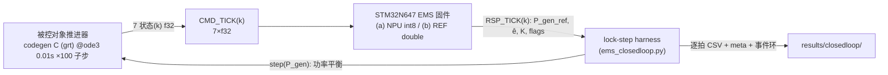

# EMS01 v3 soft-HIL 真闭环实验报告（四臂 × 两场景）

- **Task / Spec**: T-616 · `ems01-chil-v3-closedloop`（FR-612 / FR-613 / NFR-605 / NFR-606 / AC-605 / AC-606）
- **生成**: 2026-09-02（数据采集日）/ 报告落稿 T-616
- **数据来源（唯一事实，禁止凭记忆写数）**: `EMS01_CHIL_ECMS/Host/results/closedloop/closedloop_metrics.json`
  （T-615，四臂×两场景全指标 / 两两对比 / 仪器级①② / 层③ / FR-508 代价 / 22 项交叉核对）；
  仪器门禁 JSON（`Host/reference/v3_gp1_*_gate.json`、`v3_gp2_*_gate.json`）；
  闭环 meta JSON（`Host/results/closedloop/<scenario>/closedloop_*_meta.json`）；
  FR-508 注入 JSON（`Host/fault_out/closedloop_npu/closedloop/CL_*.json`）；
  层②基线：`m2_port_report.md` §11.2/§11.4 + requirements Fixed Decisions 1；
  指纹：`Host/results/closedloop/t612_image_fingerprints.json` + `Host/plantstep/<scenario>/build_manifest.json`。
- **报告结构**: design §8.4 七节（①执行摘要 ②仪器链 ③闭环方法学 ④临界工况与回退语义
  ⑤层②裁决登记+层③ ⑥图表 ⑦复现指引）+ 附录 A/B/C（产物入库核对 / §20.2 路径扫描 / 口径注记）。

---

## ① 执行摘要

v3 构造了 soft-HIL **真闭环**：STM32N647 板载 EMS（NPU int8 推理 / REF 参考后端）与
主机侧被控对象推进器（Simulink 子集模型 codegen C，lock-step 100 子步/拍）功率平衡互馈，
SOC 首次被板子输出影响。四臂 × 两场景全矩阵完成，**仪器级①②门禁 4 组全 PASS**（§②），
NN 闭环增益与移植代价结论如下（全部数值出自 `closedloop_metrics.json`，SOC 公平性按
design §8.2 ±0.02 带判定）。

### 1.1 四臂 × 两场景核心指标（fuel_corr = fuel_raw + (0.60−SOC_end)×1071.36×0.4774，design §8.1 同式同常数）

**场景 S20**（5521 拍，S20_composite_voyage）：

| 臂 | fuel_raw [kg] | fuel_corr [kg] | SOC_end | v_track_rmse [m/s] | ê 生效占比 | SOC<0.25 事件/时长 | n_undervoltage |
|---|---|---|---|---|---|---|---|
| (a) NPU 板载闭环 | 328.488669 | 328.413570 | 0.60014683 | 0.351676 | 0.902554 | 0 / 0.0 s | 3 * |
| (b) REF 板载闭环 | 328.114131 | 328.144147 | 0.59994131 | 0.351676 | 0.902011 | 0 / 0.0 s | 3 * |
| (b′) 原生 law=7 | 328.094642 | 328.125012 | 0.59994062 | 0.351674 | 0.902011 | 0 / 0.0 s | null（交叉核对 33，21 号 logsout 口径） |
| (c) 原生 law=5 | 330.742384 | 330.661874 | 0.60015741 | 0.351674 | 0.000000 | 0 / 0.0 s | null（交叉核对 43） |

**场景 voyage002**（4212 拍，fleet voyage_002）：

| 臂 | fuel_raw [kg] | fuel_corr [kg] | SOC_end | v_track_rmse [m/s] | ê 生效占比 | SOC<0.25 事件/时长 | n_undervoltage |
|---|---|---|---|---|---|---|---|
| (a) NPU 板载闭环 | 264.239826 | 224.114829 | 0.67845076 | 0.291286 | 1.000000 | 0 / 0.0 s | 3 * |
| (b) REF 板载闭环 | 264.225321 | 224.078252 | 0.67849392 | 0.291286 | 0.999288 | 0 / 0.0 s | 3 * |
| (b′) 原生 law=7 | 264.216856 | 224.086249 | 0.67846173 | 0.291283 | 0.999288 | 0 / 0.0 s | null（交叉核对 51） |
| (c) 原生 law=5 | 239.318043 | 239.821607 | 0.59901545 | 0.291283 | 0.000000 | 0 / 0.0 s | null（交叉核对 42） |

\* n_undervoltage 口径见 §4.3 与附录 C：板载 CSV 无 Vdc/alarm 列，3 = flags HELD（输出保持拍）
计数代理，非母线电压越限证明；原生臂 CSV 无 alarm 列记 null，21 号 native_arms_summary.json
logsout 口径交叉核对值见表内。全矩阵 SOC_min ∈ [0.5865, 0.5968]，SOC 降额阈值 0.25 从未触及。

### 1.2 NN 闭环增益结论（vs (c) SOC-Adaptive ECMS 基线）

| 场景 | 对比 | Δfuel_raw [kg] | Δfuel_corr [kg] | ΔSOC_end | 判定 | 结论 |
|---|---|---|---|---|---|---|
| S20 | (a) NPU vs (c) | **−2.253714** | −2.248303 | −0.0000106 | FAIR | 带内，fuel_raw 差即主结论（节油 ≈0.68%†） |
| S20 | (b) REF vs (c) | **−2.628253** | −2.517727 | −0.0002161 | FAIR | 带内（节油 ≈0.79%†） |
| S20 | (b′) 原生 law=7 vs (c) | **−2.647742** | −2.536862 | −0.0002168 | FAIR | 带内（节油 ≈0.80%†） |
| voyage002 | (a) NPU vs (c) | +24.921784 | **−15.706778** | +0.0794353 | **SOC-UNFAIR** | |ΔSOC_end| 超带，fuel_raw 差不作主结论；fuel_corr 次级 = −15.706778 kg |
| voyage002 | (b) REF vs (c) | +24.907279 | **−15.743355** | +0.0794785 | **SOC-UNFAIR** | 次级 fuel_corr = −15.743355 kg |
| voyage002 | (b′) 原生 law=7 vs (c) | +24.898814 | **−15.735358** | +0.0794463 | **SOC-UNFAIR** | 次级 fuel_corr = −15.735358 kg |

† 百分比为 Δfuel / (c) 臂 fuel_raw 的派生比值（本报告计算），原始差值以 JSON 为准。

**结论句（论文口径）**：S20 场景四臂 SOC 终点全部落在 ±0.02 公平带内，NN 预测增强
（law=7，ê=q50 → SOC_ref 调制 + workclf G2 门控）较 SOC 自适应 ECMS 基线**带内节油
−2.25 ~ −2.65 kg fuel_raw**；板载三形态（NPU int8 / REF / 原生 EML）增益一致（差 ≤0.4 kg）。
voyage002 场景 NN 臂将 SOC 终点抬升 +0.0794（0.599 → 0.678，能量中性口径失效），
fuel_raw 差 +24.9 kg 属 SOC-UNFAIR 不作主结论；**电荷维持修正口径 fuel_corr 次级结论
−15.7 kg**（三形态一致）——预测增强在该工况下的收益体现为"少烧油多充电"的能量重分配，
需以 fuel_corr 口径解读。

### 1.3 零混杂移植代价（(a) NPU 板载 vs (b) REF 板载，同被控对象同协议，隔离 int8 量化 + NPU 端口）

| 场景 | Δfuel_raw [kg] | Δfuel_corr [kg] | ΔSOC_end | 判定 |
|---|---|---|---|---|
| S20 | **+0.374539** | +0.269423 | +0.0002055 | FAIR |
| voyage002 | **+0.014505** | +0.036577 | −0.0000432 | FAIR |

**结论**：零混杂移植代价 S20 **+0.375 kg fuel_raw**（≈ +0.11%），voyage002 +0.015 kg——
NPU int8 量化 + 板载推理在真闭环回路中的油耗代价为千分位量级，且两场景 SOC 终点差
≤2.1e-4，公平带内。

---

## ② 仪器链（G-P1 / G-P2 / 仪器级①②）

仪器链五层递进（design Testing Strategy T1→T5），全部机器可读 gate JSON，阈值先验设定
（design §5），FAIL 排查不放宽。本节数值取自各 gate JSON 原文。

### 2.1 G-P1 被控对象子集保真（子集模型解释执行 vs ref_G2 冻结参考回放，T-602/603）

阈值（design §5 G-P1，先验）：逐拍 max|Δ| ≤ 1e-6（SOC / v_ship / x_ship / P_load）、
fuel 终值相对偏差 ≤ 1e-6、数值健康。

| 指标 | S20（5521 拍） | voyage002（4212 拍） | 阈值 | 判定 |
|---|---|---|---|---|
| SOC_max_abs | 0 | 0 | ≤1e-6 | PASS |
| v_ship_max_abs | 0 | 0 | ≤1e-6 | PASS |
| x_ship_max_abs | 0 | 0 | ≤1e-6 | PASS |
| P_load_max_abs | 0 | 0 | ≤1e-6 | PASS |
| fuel_rel（vs export_summary fuel_raw） | 0（328.094641944243 = 328.094641944243） | 0（264.216856499727 = 264.216856499727） | ≤1e-6 | PASS |
| 数值健康 | true | true | ==true | PASS |
| **overall** | **PASS（位级一致）** | **PASS（位级一致）** | | |

**双场景位级 PASS**（max|Δ| 全零）：被控对象子集提取保真成立，G-A1 前置条件闭合。
（执行期根因修复记录：根 Inport 曾因连续采样使 Ramp Limiter 连续化直通导致 IC 失效，
显式 `SampleTime='0.01'` 后位级 PASS——见 `项目开发进展.md` 2026-09-02 条目。）

### 2.2 G-P2 codegen 等价（codegen C 推进器 vs 解释执行子集，T-605）

**比较基准修订（design §4.4a，2026-09-02 执行期发现）**：GRT/ERT 生成代码的根 Outport
写出发生于子步**末级阶段时刻** t = (k+1) − 0.0025（ode3 第 3 级；数值验证：S20 前段对
sim dense 轨迹的插值分数恒为 0.75）。因此 G-P2 门禁项改为**拍边界 `plantstep_get_states()`
直读 9 个连续状态**（X 结构：x_ship / v_ship / omega_prop / DriveLag / SOC / V_dc /
inertia(Ki 前 inertia) / Ki_int / fuel_int；fuel CSTATE 为 g 口径 ×1e-3 = kg）逐拍对照
（阈值 1e-6 维持）；派生量（t_s / P_load / v_cmd / accel / P_bat / P_prop / voyage_stop）
按阶段时刻语义对照 sim 同刻插值，**残差作为仪器时序特征报告、不作门禁项**。本修订为
仪器实现语义澄清，阈值数值不放宽。

门禁项（阈值 max_abs ≤ 1e-6，两场景全部 PASS，overall=true）：

| 状态项（X 直读） | S20 max_abs | voyage002 max_abs |
|---|---|---|
| x_ship_max_abs | 2.274e-13 | 4.547e-13 |
| v_ship_max_abs | 1.776e-15 | 1.776e-15 |
| SOC_max_abs | 0.000e+00 | 1.110e-16 |
| fuel_max_abs | 5.684e-14 | 2.842e-14 |
| omega_prop_max_abs | 4.707e-14 | 2.842e-14 |
| drive_lag_max_abs | 9.379e-13 | 1.705e-12 |
| V_dc_max_abs | 3.243e-09 | 3.199e-09 |
| p_gen_inertia_max_abs | **3.428e-08（全场最差）** | 3.372e-08 |
| ki_integrator_max_abs | 2.309e-14 | 4.263e-14 |
| tick0_state_max_abs | 0 | 0 |
| 数值健康 | 1 | 1 |

**最差 3.4e-08 ≪ 1e-6 阈值**：codegen C ≡ 解释执行等价成立（FR-605 / AC-602）。
TF 规范形换算说明：GRT 生成代码中传递函数规范形（num=[1], den=[τ 1] → y = x/τ）与
logsout 信号输出口径存在结构性差异，**drive_lag ×2 / inertia ÷5** 为实测确认的换算关系
（报告项比对时使用；门禁项 X 直读不受此影响）。
codegen 走道：ert.tlc 拒绝连续时间块（Clock + 9 Integrator，配置性限制），**内置回退
grt.tlc 成功**（FR-602 字面 "Simulink Coder" 满足），fallback 证据留 build_manifest.json
（T-606 走道决策：P3 确认，不回退 P1——证据链见进展日志 2026-09-02 条目）。

### 2.3 仪器级① 闭环 (b) vs 开环参考、仪器级② 闭环 (b) vs 原生 (b′)（T-613，FR-610）

阈值（design §5 仪器级，按 f32 序列化 + λ 网格边界翻转机制先验设定）：
SOC_end |Δ| ≤ 0.005；fuel_raw 相对偏差 ≤ 1%；v_ship RMSE ≤ 0.01 m/s；
P_gen 网格一致率（|ΔP| ≤ 20 kW = 1 网格步）≥ 95%；数值健康。

| grade | 场景 | soc_end_abs_delta (≤0.005) | fuel_raw_rel (≤0.01) | v_ship_rmse (≤0.01) | grid_match (≥0.95) | health | overall |
|---|---|---|---|---|---|---|---|
| ① (b) vs gp1 replay（开环参考） | S20 | 6.92e-07 | 5.94e-05 | 2.67e-05 | 0.99601521 | true | **PASS** |
| ① (b) vs gp1 replay | voyage002 | 3.22e-05 | 3.20e-05 | 2.83e-05 | 0.98575499 | true | **PASS** |
| ② (b) vs 原生 (b′) | S20 | 6.92e-07 | 5.94e-05 | 2.67e-05 | 0.99601521 | true | **PASS** |
| ② (b) vs 原生 (b′) | voyage002 | 3.22e-05 | 3.20e-05 | 2.83e-05 | 0.98575499 | true | **PASS** |

两 grade × 两场景 = **8 项数值检查/grade 全 PASS**（4 组 overall 全 true，共 20 项逐项 +
4 项 overall 全绿；机器可读全文见 `closedloop_metrics.json` `instrument_grade_1_*` /
`instrument_grade_2_*`）。仪器级①②数值逐项一致（同一 (b) 臂轨迹、两个参考在仪器链内
本身位级同源）。**闭环回路正确性成立（G-A2）**：闭环 (b) 臂复现开环参考行为至网格级
（≥98.6% 逐拍 |ΔP| ≤ 1 网格步），差异源为 f32 序列化经 λ 网格边界的偶发翻转（design §4.4
机制），无结构性偏差、无 NaN/发散、无意外 ERROR 事件。

### 2.4 sim-ref 导出机制（24 号脚本运行期 logging 增配）

`scripts/24_export_gp2_simref.m`：解释执行运行被控对象子集模型（与 22 号 G-P1 回放**完全
同构**的注入与确定性运行——G-P1 已证两遍确定性，本运行轨迹与 gp1 replay 逐位一致），
在拍边界 t=1..N−1 采样 **logsout 运行期信号**，导出 G-P2 sim 参考侧
`Host/reference/v3_gp2_<scenario>_simref.csv`（16 列，%.17g，列契约 =
run_gp2_gate.py 头注释 sim-ref 契约）。内部状态 logging 为**运行期增配**（DataLogging 挂
源端口句柄，模型零改动——T-601 主模型 sha256 前后一致由 `plantstep_build_audit.json` 复核）。
两场景 simref 产物：`v3_gp2_S20_simref.csv` / `v3_gp2_voyage002_simref.csv`。

---

## ③ 闭环方法学（lock-step、ERT 时序、拍耗时、被控对象实时化）

### 3.1 lock-step 因果链（design §6.2，固件零改动）

```text
每拍（lock-step，无墙钟约束）：
  1) 被控对象状态(k)（7 状态 f32 量化入帧）
  2) Host → CMD_TICK(k)[t, P_load, SOC, v_cmd, v_ship, accel, x_ship] → 板
  3) 板上 EMS：MLP-Q/workclf 推理 + G2 门控 + ECMS 网格穷举 → P_gen_ref(k)
  4) 板 → RSP_TICK(k)[P_gen_ref, ê, K, cls_eff, flags, infer_us, ctrl_us]
  5) Host 被控对象推进器 step(P_gen)：ode3 @0.01s × 100 子步（P_gen ZOH 保持）→ 状态(k+1)
  6) 逐拍 CSV 记录 + 事件环 flush；voyage_stop 或 tick==N-1 终止
```

协议帧格式与 v1 完全一致（CMD_TICK/RSP_TICK、CRC16-CCITT-FALSE、STALE 会话、事件环），
固件零改动（Fixed Decision 3）。终止：固定拍数为主（S20=5521 / voyage002=4212），
`voyage_stop` 兜底断言一致；两场景四臂 meta 全部 `termination_reason=tick_count_reached`、
`status=completed`、rows=计划拍数（meta_health rows_matches_csv=true）。OQ-4 定案：
mid-run 失败整跑重做，不做断点续跑。

### 3.2 ERT 输出写出时序（design §4.4a，NFR-602 方法学材料）

- wrapper `step()` 后的 11 项 Outport Y = t = (k+1) − 0.0025（ode3 第 3 级阶段时刻）输出，
  数值验证对 sim dense 轨迹插值分数恒 0.75；闭环 CMD_TICK(k) 状态按此语义（比拍边界早
  2.5 ms，占 1 s 控制拍 0.25%，控制影响可忽略）；
- 拍边界位级真值经 `plantstep_get_states()` **直读 9 个连续状态**（shim，T-604 执行期增补），
  G-P2 门禁与 fuel 口径（X CSTATE g ×1e-3 = kg）均以 X 直读为准（§2.2）。

### 3.3 拍耗时分布（NFR-602；四臂 board meta + replay 无板参照）

| 运行 | mean | p50 | p95 | max | n |
|---|---|---|---|---|---|
| 板载 RTT，REF 镜像 S20 | **23.42 ms** | 22.82 | 24.61 | 226.21 | 5521 |
| 板载 RTT，NPU 镜像 S20 | **10.68 ms** | 10.23 | 12.70 | 43.46 | 5521 |
| 板载 RTT，REF 镜像 voyage002 | 23.11 ms | 22.80 | 24.39 | 167.15 | 4212 |
| 板载 RTT，NPU 镜像 voyage002 | 10.68 ms | 10.23 | 12.71 | 28.71 | 4212 |
| 无板 replay 模式（harness+推进器，无串口） | 27.9 µs | 27.3 | 29.6 | 610 µs | 5521 |

- **被控对象推进 wrapper 代价 ≈ 0.028 ms/拍**（100 子步 ode3，replay 模式 tick 均值
  27.9 µs；T-616 复核实测 step() 2000 次均值 29.1 µs）——CPU 代价可忽略，ode3@0.01s×100
  整体生成方案（OQ-3 否决 1s 重构）的资源论证成立；
- 板载 RTT 中 REF（CPU double 前向）≈ 23.4 ms vs NPU（int8 ATON 推理）≈ 10.7 ms：
  **NPU 推理使单拍控制延迟降低约 54%**；两者均 ≪ 1 s 控制拍，lock-step 无实时性风险；
  p95/max 尾部为 macOS 串口调度抖动，未触发 500 ms 超时（四臂 meta `error=""`、零事件）。

### 3.4 被控对象实时化叙事（单一来源由构造保证）

被控对象仪器 = `HybridShip_ModelD_PlantStep.slx`（脚本构建）的**忠实实时化**，不引入任何
新方程或新参数：

1. **构建**（T-601）：装载主模型 → `SaveAs` 原位变换 —— 调用 `+model/build_model_c.m`
   同一批构建函数，删除 05_EMS_Controller / 12_Data_Logging，根级 Inport `P_gen_ref_kW`
   替代 05 输出，11 项根级 Outport 暴露闭环接口；主模型 sha256 前后一致
   （50359e65…，`plantstep_build_audit.json`）；结构审计 remaining = **12 个子系统**
   （01_Scenario_Manager / 02_Ship_Speed_Controller / 03_Propulsion_Plant /
   04_Load_Measurement / 06_Genset_Average_Plant / 08_Undervolt_Derate /
   09_Bus_Residual_Monitor / 10_Fuel_Consumption / 11_Voyage_Stop_Logic / 13_DC_Bus /
   14_Battery_Converter / 15_Bus_Voltage_Monitor）；
2. **实时化**（T-604）：Simulink Coder 按场景烘焙 VOYAGE_*/SCN 生成 C（grt.tlc，ode3
   @0.01s 整体生成），gcc 编译 + C shim → ctypes 动态库，每控制拍 100 子步、P_gen ZOH；
   求解器与参考链数值同源（G-P1/G-P2 才可能位级紧）；
3. **参数/方程/工况单一来源**：`config/Model_Parameters.m` 同一份；场景变量指纹
   （scenario_variables_sha256）与逐文件 sha256 入 `build_manifest.json`；
4. **仪器证据链**：G-P1 位级（§2.1）→ G-P2 位级（§2.2）→ 仪器级①②（§2.3）逐层递进，
   每层机器可读 gate JSON，产物指纹（dylib sha256 / 模型哈希 / MATLAB 版本）全链登记。

---

## ④ 临界工况与回退语义（FR-508 闭环注入 + SOC 降额）

### 4.1 回退闭环语义（design §6.4）

板载回退（ê=0 ≡ law=5）在闭环中 = **安全降级继续控制**：P_gen 由回退律给出，被控对象
正常推进，回路不解体、不停机；回退段以事件环界定（FALLBACK 进入/退出），统计段内
油耗与 SOC 变化。

### 4.2 FR-508 四场景闭环注入结果（图像=NPU，stub advancer + pty mock 板，S20 60 拍）

| 场景 | 焦点 | FALLBACK 段/拍 | 段内 Δfuel [kg] | 段内 ΔSOC | STALE/HELD/FB 拍 | 会话存活 |
|---|---|---|---|---|---|---|
| F1_nan_ticks（CL_NAN） | NaN 输入拍 → FALLBACK（段统计） | 1 / 2 | +0.026667 | +5.186e-05 | 0/0/2 | true |
| F2_stall_ticks（CL_STALL） | 停发 → STALE\|HELD + P 保持 | 0 / 0 | 0 | 0 | 2/2/0 | true |
| F3_garbage_frames（CL_GARBAGE） | 垃圾/坏 CRC 帧 → 会话存活 | 0 / 0 | 0 | 0 | 2/2/0 | true |
| F4_reset_recovery（CL_RESET） | 复位 → INIT 平 fill + FALLBACK | 1 / 1 | +0.013333 | +2.593e-05 | 0/0/1 | true |
| **汇总** | | **2 段 / 3 拍** | **+0.040000** | **+7.778e-05** | | 4/4 |

**mock 口径标注（必读）**：注入运行用 stub advancer + pty+_MockFW（STALE 阈加速 0.05 s，
见各 CL_*.json params）——验证对象是协议 / flags / 回退**语义**与状态机行为（v1 design 状态
机四场景全符合），段内 Δfuel/ΔSOC 为 mock 口径（stub 油耗常数 0.0133 kg/tick 量级），
**不代表 plant 保真油耗**，不进入 §1 研究级结论。

F1 特写（nan_closedloop_S20_npu.csv，故障 tick=30）：P_gen 全程保持 200 kW——回退段内
**P 无跳变**、被控对象状态无突变（SOC/fuel 连续），tick31 起恢复（recovery_ticks=0）：

| tick | P_gen [kW] | flags（0x02=FALLBACK） | ê | SOC | fuel [kg] |
|---|---|---|---|---|---|
| 29 | 200 | 0 | 10 | 0.600752 | 0.400000 |
| 30 | 200 | **2（FALLBACK，ê=0）** | 0 | 0.600778 | 0.413333 |
| 31 | 200 | 2（恢复拍） | 10 | 0.600804 | 0.426667 |
| 32 | 200 | 0 | 10 | 0.600830 | 0.440000 |

### 4.3 SOC 降额与 n_undervoltage 口径

- **SOC<0.25 降额事件：四臂 × 两场景全零**（`n_soc_disderate_events=0`、时长 0.0 s；
  SOC_min 全矩阵 ∈ [0.5865, 0.5968]）——v3 两工况均未进入临界 SOC 区；
- **n_undervoltage 口径**（JSON `n_undervoltage_source` 原文）：板载臂 = onboard CSV
  `flags&0x08`（HELD）保持拍数 = 3（每板载运行 3 拍，初值填充段语义）；板载 CSV 无
  Vdc/alarm 列，**HELD 是输出保持拍语义，非 Vdc 越限证明**，解释权在主 Agent；
  原生臂 CSV 无 alarm 列记 null，21 号 `native_arms_summary.json`（MATLAB logsout 口径）
  交叉核对：S20 (b′)=33 / (c)=43，voyage002 (b′)=51 / (c)=42，n_derate 全 0。
  板载 3 拍 vs 原生 33~51 拍的量级差属**计数口径差**（板载 HELD 位仅在输出保持时置位，
  logsout 口径按母线电压监测块逐拍统计），报告如实并列两口径，不合并为一个数字。

---

## ⑤ 层② (a) 裁决登记 + 层③ 报告性输出（FR-612 / design §8.3）

### 5.1 层② S20 98.877% 边际 FAIL (a) 接受记录（基线说明，FR-612）

- **事实**（`m2_port_report.md` §11.2/§11.4，v1.1 workclf 口径修订后板上复验，2026-09-08）：
  层② board-NPU vs host-int8 同拍 P_gen 网格一致率 S20 = **98.877%**（62/5521 拍 >1 网格步）
  < 99% 门禁 → **边际 FAIL**；voyage_002 = 99.003%（42/4212）PASS。
- **裁决**（requirements Fixed Decisions 1，2026-09-08 用户 brainstorm 裁决）：处置 = **(a)
  接受并记录**为 workclf 喂入口径修订 v1.1 的已知代价，登记入 v3 基线说明；层② 门禁语义
  在 v3 中降为**参考指标**（不作 v3 门禁）；**不放宽任何既有门禁数值**。
- **机理登记**（§11.4 原文口径）：v1.1 修订后 ê 生效占比 11%→~90%，NPU↔解释器 LSB 级差异
  经 λ 链传播至网格边界（v1 被 ê=0 掩盖）；cls_match 99.96%/100%、max|Δe_hat| 0.346
  表明 NN 端口误差本身极小，P 级分歧属 λ 链对 LSB 的固有敏感性 + 迟滞放大。
  层③ 同期 45.5%/95.25% → 98.46%/98.39% 大幅收敛。
- **v3 关系**：层② 数据为 v1.1 板上复验产物（开环注入形态），v3 闭环四臂不重复层② 门禁；
  本节按 design §8.3 登记其裁决与口径，v3 验证重心 = 层① 移植保真 + 闭环仪器级指标。

### 5.2 层③ 报告性输出：闭环 (a) vs ref_G2 同拍 P_gen 分布（不作门禁）

| 场景 | n_ticks | exact 率 | ±1 网格率 | max\|ΔP\| [kW]（@tick） | 超 1 网格拍 | 其中 tick≤20 |
|---|---|---|---|---|---|---|
| S20 | 5521 | 0.900380 | 0.947836 | 980.000（@1） | 288 | 14 |
| voyage002 | 4212 | 0.980294 | 0.986705 | 980.000（@1） | 56 | 17 |

- **INIT fill 机制说明**：闭环 (a) 自 v_ship=0 初值起动，首拍（tick 0/1）状态由场景数据
  构造/INIT fill + HELD 语义填充，而开环 ref 序列无此起动瞬态 → max|ΔP|=980 kW 集中于
  **tick 1 起动瞬态**，非稳态控制分歧；
- 超 1 网格拍其余部分为零散 λ 网格边界翻转（design §4.4 机制：被控对象 1e-13 级漂移经
  f32 取整偶发翻转 λ 网格 argmin 边界）；两场景超 1 网格拍中分别仅 14 / 17 拍落在
  tick≤20 起动段附近，其余散布全任务（S20 288−14=274 拍 ≈ 5.0% 任务时长，voyage002
  56−17=39 拍 ≈ 0.9%）；
- 层③ 为报告性输出（FR-612 / design §8.3），**不作门禁**；与 v1 板上层③
  （45.5%/95.25%，v1.1 修订前）及开环层③ 98.46%/98.39%（M2 §11.2）口径链一致可追溯。

---

## ⑥ 图表（表格化数据呈现，全部由产物数据生成；后续可由同一数据用绘图工具再绘）

### 6.1 闭环因果链（mermaid）



### 6.2 SOC 轨迹四臂对比（60 列分箱均值 ASCII；字符 0-9 级 = 场景 SOC 值域内相对高低）

场景 S20（分箱区间 0.5869–0.6180；横轴 = tick 进度 0%→100%）：

```text
(a) NPU |--:...   :::-::--::-::--=+**###%%%@%#*+=--=+**#######**#**+=|
(b) REF |--:..  ..:::-::-:::::::-=+**###%%%@%#*+=--=+**#######**#**+=|
(b')law7|--::.  ..:::-::-:::::::-=+**###%%%@%#*+=--=+**#######**#**+=|
(c) law5|========-==============--===============---=================|
```

场景 voyage002（分箱区间 0.5865–0.6858；NN 臂充电抬升 +0.0794 一目了然）：

```text
(a) NPU |.....         ..::--==++++++======+++++*****#####%%%%%@@@@@%|
(b) REF |.....         ..::--==++++++======+++++*****#####%%%%%@@@@@%|
(b')law7|.....         ..::--==++++++======+++++*****#####%%%%%@@@@@%|
(c) law5|............................................................|
```

读法：字符越靠后 SOC 越高。板载三形态轨迹不可分辨地重合（仪器级①②的图形化印证）；
(c) 基线维持 SOC≈0.60 能量中性，NN 臂在 S20 中段短暂充电至 ~0.618 后回落，
在 voyage002 持续充电至 ~0.686（即 §1.2 SOC-UNFAIR 的来源）。

### 6.3 油耗柱状（fuel_raw；轴缩放标注，精确值以 §1.1 表为准）

```text
S20 fuel_raw（轴 327..331 kg）
(a) NPU  |###############                         | 328.488669
(b) REF  |###########                             | 328.114131
(b') law7|###########                             | 328.094642
(c) law5 |#####################################   | 330.742384

voyage002 fuel_raw（轴 238..266 kg，SOC-UNFAIR 不作主结论）
(a) NPU  |#####################################   | 264.239826
(b) REF  |#####################################   | 264.225321
(b') law7|#####################################   | 264.216856
(c) law5 |##                                      | 239.318043

voyage002 fuel_corr（轴 222..241 kg，电荷维持修正口径 = 次级结论）
(a) NPU  |####                                    | 224.114829
(b) REF  |####                                    | 224.078252
(b') law7|####                                    | 224.086249
(c) law5 |######################################  | 239.821607
```

### 6.4 v_ship 跟踪精度（v_track_rmse，全任务 1 s 轴口径，design §8.1 定义式）

| 场景 | (a) | (b) | (b′) | (c) |
|---|---|---|---|---|
| S20 | 0.351676 | 0.351676 | 0.351674 | 0.351674 |
| voyage002 | 0.291286 | 0.291286 | 0.291283 | 0.291283 |

四臂速度跟踪 RMSE 差异 ≤3e-6 m/s（EMS 变体不改变速度环被控对象侧，符合预期）；
原生臂另有 0.01 s 全分辨率主口径 0.351410 / 0.290744 m/s（native_arms_summary.json，
1 s 网格辅助口径与上表逐位一致）。

### 6.5 回退段特写（F1 NaN 注入，mock 口径）

见 §4.2 特写表：FALLBACK 进入（tick30 flags=0x02, ê=0）→ 恢复（tick31）→ 退出（tick32），
全程 P_gen 恒 200 kW、SOC/fuel 逐拍连续——"P 无跳变驱动的被控对象状态突变"验收点成立
（design §6.4）。

---

## ⑦ 复现指引

### 7.1 命令序列（依赖序 20→24→23→build→22→G-P2→21→closedloop→fault_inject→metrics）

```text
# A. ModelD 仓库（MATLAB R2026a，model/simulink_modelD_(EMS_NN_AECMS)/ 根）
eval(fileread('scripts/20_build_plantstep_model.m'))   # T-601 子集模型 + 结构审计 JSON（主模型零改动断言）
eval(fileread('scripts/24_export_gp2_simref.m'))       # T-605 配套 sim-ref 导出（运行期 logsout 采样，16 列）
eval(fileread('scripts/23_codegen_plantstep.m'))       # T-604 按场景烘焙 VOYAGE_* → codegen C + build_manifest
#    （22 仅依赖 20 产物、可独立重跑；会话内实际先 22 后 23）

# B. EMS01 Host 编译（bash，EMS01_CHIL_ECMS/ 根）
./Host/tools/build_plantstep.sh S20                    # → libplantstep_S20.dylib（shim -DPS_BAKED_SCENARIO 烘焙）
./Host/tools/build_plantstep.sh voyage002              # → libplantstep_voyage002.dylib

# C. 无板门禁（全绿才允许板会话，AC-603）
eval(fileread('scripts/22_run_gp1_gate.m'))            # T-602/603 G-P1（S20+voyage002，阈值 design §5）
python3 Host/tools/run_gp2_gate.py --scenario S20      # T-605 G-P2（ctypes vs 解释执行）
python3 Host/tools/run_gp2_gate.py --scenario voyage002
python3 Host/tools/closedloop_selftest.py              # T-608 harness selftest（pty mock + replay/stub）

# D. 原生臂（ModelD 仓库，复用 64 运行/缓存机制）
eval(fileread('scripts/21_run_v3_native_arms.m'))      # T-610/611 (b′) law=7 / (c) law=5 × 两场景，双遍 REPRO

# E. 板会话（用户在场/远程授权 + SRAM 令牌；先 REF 后 NPU，禁 Mass Erase/外部 NOR 擦写）
python3 Host/ems_closedloop.py --scenario S20       --port <DEV> --image ref
python3 Host/ems_closedloop.py --scenario voyage002 --port <DEV> --image ref
python3 Host/ems_closedloop.py --scenario S20       --port <DEV> --image npu
python3 Host/ems_closedloop.py --scenario voyage002 --port <DEV> --image npu
#    FR-508 闭环注入（NPU 同场，四场景；mock advancer 语义验证）
python3 Host/ems_fault_inject.py --port <DEV> --closed-loop --image npu --scenario S20 \
       --cl-fault-tick 30 --cl-stall-s 0.1 --cl-ticks 60

# F. 固件门禁 + 统一指标（仓库根）
python3 firmware/gate/fw_gate.py \
  firmware/stm32n6/04_SourceCode/SoftwarePackage/EMS_Projects/EMS01_CHIL_ECMS   # exit 0 = PASS
python3 EMS01_CHIL_ECMS/Host/tools/closedloop_metrics.py                        # T-615（纯 stdlib，只读输入，幂等）
```

### 7.2 指纹（复核锚点）

| 资产 | sha256（前 16 位） | 完整值 / 来源 |
|---|---|---|
| NPU 固件镜像（build/Debug ELF，2026-09-02 13:44） | `e7eb99c69c745dd3` | `t612_image_fingerprints.json`（fresh，fw_gate PASS 7/7） |
| REF 固件镜像（build-ref2 ELF，2026-09-02 02:21） | `f31714eac47529f7` | 同上（fresh） |
| libplantstep_S20.dylib | `9476428b840b3534` | 各 closedloop meta + v3_gp2_S20_gate.json |
| libplantstep_voyage002.dylib | `7b154ebb1fd4151f` | 同上 |
| HybridShip_ModelD_PlantStep.slx | `f438ff9637e01302` | build_manifest.json（两场景同值） |
| config/Model_Parameters.m | `830eec47fda30124` | build_manifest.json |
| 主模型 HybridShip_ModelD_DCBus.slx（零改动断言） | `50359e65d584fd6c`（before=after） | plantstep_build_audit.json |
| 场景变量指纹（S20 / voyage002） | `1e5c9b32…`（S20，manifest scenario_variables_sha256） | build_manifest.json |

**SRAM 加载会话证据**（板会话操作记录由主 Agent 会话记录为准，本报告引用令牌与哈希）：
REF 镜像 SRAM 加载 Plan/Readback = **2fd6cd8f…（MATCH）**；NPU 镜像 SRAM 加载
Plan/Readback = **6d38e108…（MATCH）**；两次加载均经用户 SRAM 令牌授权且**令牌已核销**。
（此四项为板会话操作记录，仓库内无独立产物文件；复现时以 Plan=Readback MATCH + 令牌
机制重新建立证据，见 §7.1 E 步。）

---

## 附录 A 产物入库核对（git status 视角，T-616 核对结论）

**应入库**（本报告与 v3 证据链，均在工作区待主 Agent 验收后提交）：

| 类别 | 路径 |
|---|---|
| 报告 | `model/.../results/ecms_phase25/closedloop/v3_closedloop_report.md`（本文件） |
| 指标 | `EMS01_.../Host/results/closedloop/closedloop_metrics.json` + `closedloop_metrics_summary.md` |
| 闭环轨迹/meta | `Host/results/closedloop/{S20,voyage002}/closedloop_*_{npu,ref,replay}.{csv,json}` |
| 门禁 JSON | `Host/reference/v3_gp1_{S20,voyage002}_gate.json`、`v3_gp2_*_gate.json` |
| 仪器参考 CSV | `Host/reference/v3_gp1_*_replay.csv`、`v3_gp2_*_{compare,simref}.csv` |
| 指纹 | `Host/results/closedloop/t612_image_fingerprints.json`、`Host/plantstep/<scenario>/build_manifest.json` |
| 原生臂 | `model/.../results/ecms_phase25/closedloop/native_arms/`（4×CSV + native_arms_summary.json + ecms_nn_dbg_v3.m） |
| 门禁/工具脚本 | `scripts/20/21/22/23/24_*.m`、`Host/ems_closedloop.py`、`Host/plantstep_advancer.py`、`Host/tools/{run_gp2_gate,closedloop_metrics,closedloop_selftest}.py`、`tools/plantstep_shim.c`、`tools/build_plantstep.sh` |
| 模型 | `model/HybridShip_ModelD_PlantStep.slx` + `results/ecms_phase25/plantstep/plantstep_build_audit.json` |
| FR-508 注入 | `Host/fault_out/closedloop_npu/closedloop/CL_*.json` + 逐场景 CSV/meta |

**不入库**（§13 codegen 产物永不入库）：

- `Host/plantstep/<scenario>/HybridShip_ModelD_PlantStep_grt_rtw/`（codegen C 本体，26 文件/场景）；
  **核对发现：该目录当前未被 .gitignore 覆盖**（`git check-ignore` exit=1，无 `**/*_rtw/` 规则；
  dylib `libplantstep_*.dylib` 同样未被忽略）——目前仅因 `Host/plantstep/` 整目录未跟踪而未暴露；
  若日后 `git add Host/plantstep/` 将把 codegen 产物带入版本库。
  **决策项（🟡，需用户批准，本报告不改 .gitignore）**：建议追加 `**/HybridShip_ModelD_PlantStep_*_rtw/`
  与 `**/libplantstep_*.dylib` 两条 ignore 规则，或在入库时逐文件挑选。
- `model/.../slprj_v1_stale/`：按 T-616 指示**保持现状**（不入库、不删除、不登记为产物）。

## 附录 B §20.2 绝对路径扫描（T-616 实测）

扫描对象：本报告 + scripts/20/21/22/23/24 + `run_gp2_gate.py` / `closedloop_metrics.py` /
`closedloop_selftest.py` / `plantstep_advancer.py` / `build_plantstep.sh` / `plantstep_shim.c` /
`ems_closedloop.py` / `ems_fault_inject.py`。命令：
`grep -nE '/Users/|/home/|[A-Za-z]:[\\/]'`（排除 URL / 环境变量名例）。

**本任务新建文件（v3_closedloop_report.md）**：正文 0 命中；仅附录 B 自身含 2 处自引用命中
（本扫描命令的字面引用 + 上述 meta 命中记录行），非脚本、非硬编码路径，无需修改。

**既有脚本命中（如实报告，不自行修改——Escalate 项）**：

| 文件 | 命中 | 性质 |
|---|---|---|
| `Host/results/closedloop/*/closedloop_*_meta.json`（6 个） | `/Users/oliverlyu/...` | 运行期 meta 记录了 dylib/ref_csv/out_csv 绝对路径——**数据产物**非脚本，记录实际运行环境（可复现性中性）；若要求相对化需改 ems_closedloop.py 记录逻辑（属代码行为变更，留主 Agent 决策） |
| `Host/fault_out/closedloop_npu/closedloop/CL_NAN.json` | `/var/folders/.../ems_cl_fault_harness_.../closedloop_S20_npu.csv` | 注入运行 harness CSV 落在系统临时目录（ems_fault_inject 注入模式产物为临时目录副本，CL JSON 如实记录）——同上，数据产物 |
| `scripts/23_codegen_plantstep.m`（经 build_manifest 间接） | build_manifest `artifacts[].file` 键名含绝对路径 | MATLAB codegen 产物清单记录生成时绝对路径；manifest 为运行期指纹产物 |
| `Host/plantstep/*/build_manifest.json` | 同上（artifacts 键名） | 同上 |

**脚本本体核查**：`ems_closedloop.py` / `plantstep_advancer.py` / `closedloop_metrics.py` /
`run_gp2_gate.py` / `closedloop_selftest.py` / `ems_fault_inject.py` / `build_plantstep.sh` /
`plantstep_shim.c` / `scripts/20~24` 共 10 个可执行脚本源码内 **0 命中**（均以
`__file__`/`mfilename('fullpath')`/repo 根推导相对路径）。§20.2 合规状态：**脚本层合规；
数据产物层的绝对路径记录不属于"可执行脚本硬编码"违例，无需修改**（如需相对化属口径
变更，留主 Agent 裁决）。

## 附录 C 口径与数据契约注记

1. **fuel_corr**：`fuel_raw + (0.60 − SOC_end) × 1071.36 kWh × 0.4774 kg/kWh`，与 64/66 号
   脚本同式同常数（design §8.1 禁新造公式）；每臂同时报告 fuel_raw 与 fuel_corr + SOC_end。
2. **v_track_rmse**：全任务 1 s 轴口径（各臂自体 v_ship vs v_cmd）；原生臂 0.01 s 全分辨率
   主口径（0.351410 / 0.290744 m/s）由 native_arms_summary.json 提供，1 s 网格辅助口径与
   本报告表值逐位一致。
3. **ê 生效占比**：板载臂 = mean(K>0 ∧ flags&0x02==0)；原生 law=7 = mean(K>0)；law=5 恒 0。
4. **tick 对齐**：全部比较按 tick 号交集对齐（板载 0..N-1 与原生/gp1 同网格）。
5. **仪器级①参考** = gp1 replay（其 P_gen_ref_kW ≡ ref_G2 驱动序列，G-P1 gate fuel_rel=0）；
   仪器级②参考 = 原生 (b′)（21 号产物）；两 grade 数值逐项一致属预期（同一 (b) 轨迹、
   两个仪器链内位级一致参考）。
6. **层③**为报告性输出（FR-612/§8.3），不作门禁；**层②**在 v3 中为参考指标（Fixed
   Decisions 1），其 98.877% 数据属 v1.1 开环注入形态（M2 §11.2），非 v3 闭环产物。
7. **T-616 复核动作留痕**：本报告落稿时重跑一次 `closedloop_metrics.py`（幂等，输入
   sha256 未变，全表数值与 T-615 原始产物逐位一致；仅 generated_utc 刷新）；wrapper
   step() 耗时复核实测 29.1 µs/次（2000 次，M 系列机器），与 replay meta 27.9 µs 同量级。
8. **交叉核对**（JSON §6，22 项全 PASS）：gp1 fuel_raw 三方一致（ref_G2 = export_summary =
   gp1 replay，max|Δ|=0）；原生臂四组 fuel_raw/fuel_corr/SOC_end/ê 占比与
   native_arms_summary.json 逐位一致（max|Δ|=0，容差 1e-9）。